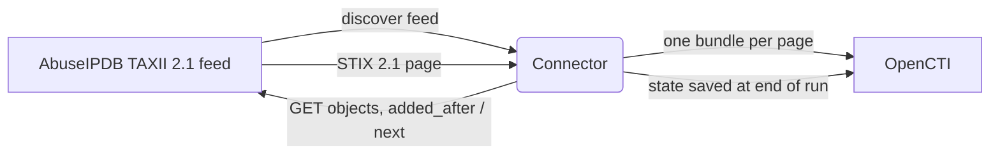

# OpenCTI AbuseIPDB TAXII Connector

Table of Contents

- [OpenCTI AbuseIPDB TAXII Connector](#opencti-abuseipdb-taxii-connector)
  - [Introduction](#introduction)
  - [Installation](#installation)
    - [Requirements](#requirements)
  - [Configuration variables](#configuration-variables)
  - [Deployment](#deployment)
    - [Docker Deployment](#docker-deployment)
    - [Manual Deployment](#manual-deployment)
  - [Usage](#usage)
  - [Behavior](#behavior)
  - [Debugging](#debugging)
  - [Additional information](#additional-information)

## Introduction

[AbuseIPDB](https://www.abuseipdb.com) is a community-driven project dedicated to fighting
hackers, spammers, and abusive activity on the internet. Besides its REST API (see the
`abuseipdb-ipblacklist` connector), AbuseIPDB publishes
[TAXII 2.1](https://docs.oasis-open.org/cti/taxii/v2.1/taxii-v2.1.html) feeds that serve
reported IP addresses as STIX 2.1 Indicators.

This connector authenticates to the AbuseIPDB TAXII 2.1 API root, discovers the account's
feed (or uses the feed chosen by its Collection ID when the account has several), and
relays every STIX object the feed serves into OpenCTI, page by page. The objects
are passed through unchanged, so they keep the identity, labels and external references
AbuseIPDB attaches to them. The connector creates no STIX objects of its own.

## Installation

### Requirements

- Python >= 3.11
- OpenCTI Platform >= 7.261117.0
- [`pycti`](https://pypi.org/project/pycti/) library matching your OpenCTI version
- [`connectors-sdk`](https://github.com/OpenCTI-Platform/connectors/tree/master/connectors-sdk) library matching your OpenCTI version
- An AbuseIPDB account with STIX/TAXII access and at least one TAXII feed, created on the
  account's My TAXII Feeds page. When the account has one feed, it is discovered at
  runtime and no Collection ID is configured. When it has more than one, set
  `ABUSEIPDB_TAXII_COLLECTION_ID` to the feed to import. The write-only AbuseIPDB reports
  collection is ignored. An account with no feed, or with several feeds and no Collection
  ID set, is reported as an error in the connector log.

## Configuration variables

Find all the configuration variables available here: [Connector Configurations](./__metadata__/CONNECTOR_CONFIG_DOC.md)

_The `opencti` and `connector` options in the `docker-compose.yml` and `config.yml` are the same as for any other connector.
For more information regarding variables, please refer to [OpenCTI's documentation on connectors](https://docs.opencti.io/latest/deployment/connectors/)._

- `ABUSEIPDB_TAXII_USERNAME`: your AbuseIPDB account email.
- `ABUSEIPDB_TAXII_PASSWORD`: one of your AbuseIPDB API keys, not your account password.
  Both are sent as HTTP Basic authentication. Set them through environment variables or
  `config.yml`. There is no file-based secret option.
- `ABUSEIPDB_TAXII_COLLECTION_ID`: the Collection ID of the feed to import, shown for each
  feed on your My TAXII Feeds page (the ID itself, not the collection URL). Only needed
  when the account has more than one feed; leave it unset or empty otherwise.
- `ABUSEIPDB_TAXII_IMPORT_SINCE`: where the first pull starts on an Enterprise feed, as an
  ISO 8601 duration relative to now (default `P30D`) or an absolute datetime. A start older
  than the feed's look-back window is served from the start of that window. Free and Paid
  feeds ignore it. The start is resolved on the first run and saved in the connector
  state, so a later change takes effect only after a state reset.
- `ABUSEIPDB_TAXII_PAGE_SIZE`: objects requested per page (default `1000`, range `10` to
  `1000`). It does not limit a pull: pages are fetched until the feed reports `more: false`.
- `CONNECTOR_DURATION_PERIOD`: time between two runs (default `PT1H`). AbuseIPDB recommends
  starting a sync once an hour on Free and Paid plans, and at the interval agreed with
  AbuseIPDB on the Enterprise plan.
- `CONNECTOR_LOG_LEVEL`: defaults to `error`. Set it to `info` to see the per-run summary.

## Deployment

### Docker Deployment

The image is built against the `pycti` version pinned in `src/requirements.txt` and needs an OpenCTI platform of
that version or newer. An older platform rejects the connector's registration.

Build a Docker Image using the provided `Dockerfile`.

Example:

```shell
# Replace the IMAGE NAME with the appropriate value
docker build . -t [IMAGE NAME]:latest
```

Make sure to replace the environment variables in `docker-compose.yml` with the appropriate configurations for your
environment. Then, start the docker container with the provided docker-compose.yml

```shell
docker compose up -d
# -d for detached
```

### Manual Deployment

Create a file `config.yml` based on the provided `config.yml.sample`.

Replace the configuration variables (especially the "**ChangeMe**" variables) with the appropriate configurations for
you environment.

Install the required python dependencies (preferably in a virtual environment):

```shell
cd src
pip3 install -r requirements.txt
```

Then, start the connector from `src`:

```shell
python3 main.py
```

## Usage

After Installation, the connector should require minimal interaction to use, and should update automatically at a
regular interval specified in your `docker-compose.yml` or `config.yml` in `duration_period` (one hour by default).

However, if you would like to force an immediate download of a new batch of entities, navigate to:

`Data management` -> `Ingestion` -> `Connectors` in the OpenCTI platform.

Stop the connector container, find the connector, click on the refresh button to reset the
connector's state, then start the container again. A running connector keeps its position in memory
and saves it again at the end of each run, so a reset while it is running has no lasting effect.

## Behavior



- **One pull per run.** Each run requests pages back to back while the feed answers
  `more: true` and stops at the first `more: false`. There is no local limit on pages or
  indicators.
- **Enterprise feeds.** The first pull starts at `ABUSEIPDB_TAXII_IMPORT_SINCE`. Each later
  pull sends, as `added_after`, the `X-TAXII-Date-Added-Last` value of the last completed
  pull. The boundary is inclusive, so the last indicators of one pull can arrive again in
  the next; OpenCTI updates them by ID.
- **Free and Paid feeds.** AbuseIPDB keeps your place in the feed, ignores `added_after`
  and `next`, and serves forward until the daily cap. Once the cap is used, the feed
  returns no objects until the next UTC day. An answer with `more: false` and no objects
  means either that nothing new matches the feed or that the day's cap is used up. The
  connector cannot tell which, treats both as the end of the pull, does not track the cap,
  and does not wait for the next UTC day: the next scheduled run simply asks again.
- **High-water mark.** The first run saves the start resolved from
  `ABUSEIPDB_TAXII_IMPORT_SINCE`, so a first pull that is interrupted, or a container that
  restarts before a pull completes, begins again from the same start. After that, the
  saved timestamp advances only when a pull reaches `more: false`, and only from the
  server's `X-TAXII-Date-Added-Last` header. If the header is missing or unreadable, the
  previous value is kept. The connector never substitutes its own clock for it.
- **Interrupted pulls.** State is saved once, at the end of a run. If a request still fails
  after its retries, the connector logs the error, ends the run, and saves the cursor of
  the first page that was not yet handed to OpenCTI; the next run resumes there. A position
  is recorded only after its page was handed to OpenCTI. If the process is killed, nothing
  from that run is saved, so the next run starts again from the last saved position (the
  timestamp, or the cursor an earlier run recorded): pages already sent are sent again and
  merged by ID, never skipped. If AbuseIPDB rejects a saved cursor (HTTP 400), or returns a
  cursor it already returned earlier in the same pull, the connector drops the cursor and
  the next run restarts from the saved timestamp. An unexpected error that is not a
  transport, server or response failure fails the work, if one was opened, and nothing from
  that run is saved. On Free and Paid feeds the saved cursor and timestamp have no effect,
  because AbuseIPDB holds the position; a page that was fetched but not delivered before a
  hard stop is not requested again by the connector.
- **Request recovery.** Each request is retried up to five times on connection errors,
  timeouts before the response arrives, and HTTP 408, 429, 500, 502, 503 and 504, with
  exponential backoff. A response that breaks off mid-body is not retried. The server may
  rate-limit requests; the connector honors `Retry-After`. There is no retry setting.
- **Works.** A work is opened only when the feed serves objects, with one bundle per page.
  A pull that stops early is reported in the connector log, not on the work.
- **Run summary.** At `info` level each run logs `pages`, `objects_submitted` and
  `drained`. These numbers describe what was submitted to OpenCTI, not what the workers
  finally persisted: workers may merge, reject, or still be processing objects.
- **How this was verified.** The Free and Paid behavior, the change of UTC day, and the
  interruption cases are covered by automated tests against a simulated TAXII service,
  not against the live service.

## Debugging

Set `CONNECTOR_LOG_LEVEL=debug` for verbose output. A pull that stops early is logged at
error level with a fixed message and an error type. The connector's own messages never
contain credentials, URLs, collection IDs, cursors, or response bodies. At `info` level the
SDK logs the saved connector state, which includes the resume cursor (an opaque position
token, not a credential) and the Collection ID of the feed.

- "has no readable TAXII feed": create a feed on My TAXII Feeds.
- "has several readable TAXII feeds": set `ABUSEIPDB_TAXII_COLLECTION_ID` to the
  Collection ID of the feed to import, as shown on My TAXII Feeds.
- "is not one of the AbuseIPDB account's readable TAXII feeds": the configured Collection
  ID does not match any feed of the account. Copy the Collection ID, not the collection
  URL, from My TAXII Feeds, and check the feed is active.
- HTTP 401: use your AbuseIPDB account email as the username and one of your API keys as
  the password, and check the key is still listed on your API keys page.

## Additional information

- API key rotation: update `ABUSEIPDB_TAXII_PASSWORD` and recreate the connector container.
  Restarting keeps the connector state in OpenCTI. Resetting the state while the container
  is stopped, then starting it, replays an Enterprise feed from
  `ABUSEIPDB_TAXII_IMPORT_SINCE`; a relative value such as `P30D` is measured from the
  moment the container starts.
- Several feeds: run one connector container per feed, each with its own `CONNECTOR_ID`
  and `ABUSEIPDB_TAXII_COLLECTION_ID`. On Free and Paid plans all feeds of an account
  share its daily cap.
- Changing feeds: when the feed the connector imports changes, because
  `ABUSEIPDB_TAXII_COLLECTION_ID` was changed or the account's only feed was replaced, the
  connector drops the saved position on its next run and imports the new feed from
  `ABUSEIPDB_TAXII_IMPORT_SINCE`. No state reset is needed.
- Feeds in any AbuseIPDB output format are relayed as served.
- This connector complements, and does not replace, the `abuseipdb-ipblacklist` connector:
  that one pulls the REST blacklist and builds observables itself, this one relays the
  Indicators AbuseIPDB already publishes as STIX over TAXII.
