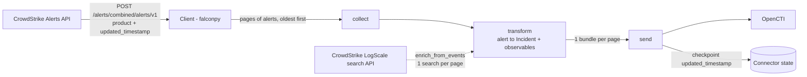

# OpenCTI CrowdStrike Incidents Connector

Table of Contents

- [Introduction](#introduction)
- [Installation](#installation)
  - [Requirements](#requirements)
- [Configuration variables](#configuration-variables)
- [Deployment](#deployment)
  - [Docker Deployment](#docker-deployment)
  - [Manual Deployment](#manual-deployment)
- [Usage](#usage)
- [Behavior](#behavior)
  - [Data flow](#data-flow)
  - [STIX 2.1 mapping](#stix-21-mapping)
  - [Incremental collection and resilience](#incremental-collection-and-resilience)
- [Known caveats](#known-caveats)
- [Debugging](#debugging)
- [Additional information](#additional-information)

## Introduction

[CrowdStrike Falcon Next-Gen SIEM](https://www.crowdstrike.com/platform/next-gen-siem/) raises
**alerts** when one of its **correlation rules** matches the logs ingested in the platform.

This connector retrieves these Next-Gen SIEM alerts through the CrowdStrike Falcon **Alerts API**
and imports each of them into OpenCTI as an **Incident**, with:

- the **victim** observables: hosts, IP addresses and user accounts involved;
- the MITRE ATT&CK techniques declared by the correlation rule;
- optionally (`enrich_from_events`), the **threat** observables read from the alert's source event
  in Next-Gen SIEM: the executed file and its hashes, and its execution context.

```
Incident « <rule> on <host> »
├── Victim      : Hostname · IPv4/IPv6 (internal and public) · User-Account
├── Threat      : File (name, SHA-256, MD5, SHA-1)            ← enrich_from_events
├── TTP         : Attack-Pattern (MITRE ATT&CK), if declared by the rule
└── Description : alert context + command line and process chain  ← enrich_from_events
```

> Next-Gen SIEM alerts only exist when a correlation rule fires. The alert payload only describes
> the affected assets; the threat side (file, hashes, command line) lives in the source event,
> stored in LogScale and read through the LogScale search API.

## Installation

### Requirements

- OpenCTI Platform >= 7.261008.0
- A CrowdStrike Falcon API client (Support and resources > API clients and keys) with the scopes:

  | Scope | Access | Needed for |
  |---|---|---|
  | **Alerts** | Read | Always: retrieving the alerts. Source: [PSFalcon `Get-FalconAlert`](https://github.com/CrowdStrike/psfalcon/blob/master/public/alerts.ps1) ("Requires 'Alerts: Read'"). |
  | **NGSIEM** | **Read and Write** | Only with `enrich_from_events`: reading the source events requires starting a LogScale search (`POST /humio/api/v1/repositories/{repository}/queryjobs`), which is refused with Read only (`403 access denied, scope not permitted`, verified on a tenant). The connector never writes data to Next-Gen SIEM: the Write access is only needed to start searches. |
- The base URL of the CrowdStrike cloud region of the tenant, e.g. `https://api.crowdstrike.com`
  (US-1), `https://api.us-2.crowdstrike.com` (US-2), `https://api.eu-1.crowdstrike.com` (EU-1).

## Configuration variables

The exhaustive, generated list of every parameter is available in
[Connector Configurations](./__metadata__/CONNECTOR_CONFIG_DOC.md).

Main parameters (environment variable prefix `CROWDSTRIKE_INCIDENTS_`):

| Parameter            | Default                       | Description                                                                                      |
|----------------------|-------------------------------|--------------------------------------------------------------------------------------------------|
| `api_base_url`       | `https://api.crowdstrike.com` | Base URL of the CrowdStrike API for the tenant's cloud region.                                   |
| `client_id`          | (required)                    | CrowdStrike API client ID.                                                                       |
| `client_secret`      | (required)                    | CrowdStrike API client secret.                                                                   |
| `import_start_date`  | `P7D`                         | How far back to look on the first run (ISO 8601 duration). Ignored once a cursor is stored.      |
| `products`           | `ngsiem`                      | Alert products to import. **Only `ngsiem` is supported**; other values are ignored with a warning, and the connector does not start if no supported value remains. |
| `severity_min`       | (none)                        | Minimum severity to import: `informational`, `low`, `medium`, `high` or `critical`.              |
| `include_hidden`     | `false`                       | Also import the alerts hidden in the Falcon console.                                             |
| `enrich_from_events` | `false`                       | Enrich each Incident with the threat observables of the alert's source event. Requires the **NGSIEM: Write** scope (see Requirements). |
| `tlp_level`          | `amber+strict`                | TLP marking applied to every created object.                                                    |
| `connector.duration_period` | `PT5M`                 | Interval between two runs.                                                                       |

In-code constants (not configurable):

| Constant   | Value                                     | Notes                                                                 |
|------------|-------------------------------------------|-----------------------------------------------------------------------|
| Page size  | 1000 alerts                               | Maximum of `POST /alerts/combined/alerts/v1`.                         |
| User-Agent | `OpenCTI-CrowdStrike-Incidents-Connector` | Sent on every API call.                                               |
| Auth       | OAuth2 client credentials                 | Token request, refresh and retries are handled by the official [falconpy](https://github.com/CrowdStrike/falconpy) SDK. |
| Event search view | `search-all`                       | LogScale view used for the source events (searching the repositories directly is forbidden). |
| Alerts per event search | 1000                         | One search per page of alerts; LogScale queries are limited to 66 000 characters. |
| Events per alert (search result margin) | 3                | The search returns at most 3 events per alert (search results are capped by `head`). |
| Event search timeout | 300 s, polled every 2 s           | A search not completed in time is stopped; the page is imported without enrichment. |

## Deployment

### Docker Deployment

Build the image, or use the published one:

```shell
docker build . -t opencti/connector-crowdstrike-incidents:latest
```

Fill in the environment variables of `docker-compose.yml`, then:

```shell
docker compose up -d
```

### Manual Deployment

```shell
cp config.yml.sample src/config.yml   # then fill in the values
pip install -r requirements.txt
cd src
python main.py
```

## Usage

The connector runs every `duration_period`. To force an immediate run, go to
**Data management > Ingestion > Connectors**, select the connector and click the refresh button.

To re-import from scratch, reset the connector state from the same page: the next run starts again
from `now - import_start_date`.

## Behavior

### Data flow



API reference:

| Step                                          | Endpoint                          | falconpy                      |
|-----------------------------------------------|-----------------------------------|-------------------------------|
| Get alerts (complete payload, 1000 per call)  | `POST /alerts/combined/alerts/v1` | `Alerts.get_alerts_combined`  |
| Start a source events search (`enrich_from_events`) | `POST /humio/api/v1/repositories/search-all/queryjobs` | `NGSIEM.start_search` |
| Poll / stop the search | `GET` / `DELETE /humio/api/v1/repositories/search-all/queryjobs/{id}` | `NGSIEM.get_search_status` / `NGSIEM.stop_search` |

The FQL filter is `product:['ngsiem']+updated_timestamp:>='<cursor>'+show_in_ui:true`, sorted by
`updated_timestamp|asc` (`show_in_ui:true` is dropped when `include_hidden` is enabled). The `ngsiem` product value is documented in CrowdStrike's
[falcon-mcp `detections.py`](https://github.com/CrowdStrike/falcon-mcp/blob/main/falcon_mcp/resources/detections.py).

### STIX 2.1 mapping

Each alert produces one **Incident** and its related objects. Every object is created by the
`CrowdStrike` organization and carries the configured TLP marking.

#### Alert → Incident

| CrowdStrike field                             | OpenCTI Incident        | Notes                                                                                                     |
|-----------------------------------------------|-------------------------|-----------------------------------------------------------------------------------------------------------|
| `display_name`, `host_names[0]`               | `name`                  | `<rule> on <host>`. Falls back to `name` for the rule, to `<rule>` without host, then to `composite_id`. |
| `description`                                 | `description`           | Followed by a table: users, product, type, status, priority, priority explanation, detection ID, event IDs. |
| `severity_name`                               | `severity`              | `Informational` and `Low` → `low`, `Medium` → `medium`, `High` → `high`, `Critical` → `critical`.         |
| —                                             | `incident_type`         | Always `alert`.                                                                                           |
| `product`                                     | `source`                | `CrowdStrike Falcon Next-Gen SIEM`.                                                                       |
| `created_timestamp`                           | `created`               |                                                                                                           |
| `start_time` / `end_time`                     | `first_seen` / `last_seen` | Detection window of the correlation rule.                                                              |
| `mitre_attack[].tactic`                       | `labels`                | e.g. `Execution`, `Persistence`.                                                                          |
| `falcon_host_link`, `composite_id`            | External reference      | `source_name` `CrowdStrike Falcon Next-Gen SIEM`, `url` = console link, `external_id` = `composite_id`.   |

The Incident STIX ID is generated from its `name` and `created` date, which do not change when the
alert is updated in CrowdStrike: an updated alert updates the existing Incident instead of creating
a new one. The user is deliberately **not** part of the name (it is listed in the description):
users can be added to an alert after its creation, and a name change would create a duplicate
Incident.

#### Related objects

| CrowdStrike field                 | OpenCTI object                          | Relationship (from the Incident) |
|-----------------------------------|-----------------------------------------|----------------------------------|
| `host_names[]`                    | `Hostname` observable                   | `related-to`                     |
| `source_ips[]`                    | `IPv4-Addr` / `IPv6-Addr` observable    | `related-to`                     |
| `users[].user_name`, `users[].sid` (or `user_names[]`) | `User-Account` (`account_login`, `user_id`) | `related-to`  |
| `mitre_attack[].technique_id`, `technique` | `Attack-Pattern`               | `uses`                           |

Attack Patterns are only created for MITRE ATT&CK IDs (`T1234` or `T1234.567`). Their STIX ID only
depends on the MITRE ID, so they **merge with the techniques already imported** by the MITRE ATT&CK
connector instead of creating duplicates. For the same reason they carry **no author and no TLP
marking**: adding the connector's marking to the shared ATT&CK techniques would hide them from users
not cleared for it. The `uses` relationship itself carries the author and the marking.

#### Source event → threat observables (`enrich_from_events`)

Each Next-Gen SIEM alert has a `ngsiem-rule-match-event` in LogScale, keyed by
`Ngsiem.indicator.id` (the last segment of the alert `composite_id`). The connector retrieves the
events of a whole page with a single search:

```
Ngsiem.event.type="ngsiem-rule-match-event"
| in(field="Ngsiem.indicator.id", values=[<up to 1000 IDs>])
| head(limit=<number of IDs>)
```

The search window starts from the oldest detection window (`start_time`) of the page minus one hour:
a source event can predate its alert by days (correlation rule lookback).

| Source event field | OpenCTI | Relationship / notes |
|---|---|---|
| `Vendor.FileName` | `File` name | Incident `related-to` File (threat) |
| `process.hash.sha256`, `process.hash.md5`, `process.hash.sha1` | `File` hashes | Hashes made only of zeros, and malformed hashes (not hexadecimal or wrong length), are dropped (see Known caveats) |
| `Vendor.aip` | `IPv4-Addr` / `IPv6-Addr` | Incident `related-to` IP: public IP of the affected host (victim) |
| `process.command_line` | Incident description, "Command line" row | Temporary, see Known caveats |
| `process.executable` | Incident description, "Executable" row | |
| `Vendor.GrandParentBaseFileName`, `process.parent.name`, `Vendor.FileName` | Incident description, "Process chain" row | e.g. `cmd.exe → powershell.exe → implant.exe` |
| `threat.tactic.name`, `threat.technique.name` | — | Not mapped: names without MITRE ID; the alert provides the IDs when the rule declares them |

No Indicator is created from the file hashes.

#### Not mapped

`agent_id`, `aggregate_id`, `cid`, `origin_cid`, `correlation_rule_*`, `crawled_timestamp`,
`timestamp`, `seconds_to_resolved`, `seconds_to_triaged`, `show_in_ui`, `poly_id`, `pattern_id`,
`vendor_pattern_id`, `priority_details`, `data_domains`, `source_products`, `source_vendors`,
`source_hosts` (duplicate of `host_names`), `usernames` (duplicate of `user_names`),
`enriched_entities` (always empty on Next-Gen SIEM alerts).

### Incremental collection and resilience

- **Cursor**: `updated_timestamp`. Alerts updated in CrowdStrike after their first import (status
  change, etc.) are fetched again and update the existing Incident.
- **One call per page**: `POST /alerts/combined/alerts/v1` returns complete alerts, so each page is
  a consistent snapshot (no gap between listing IDs and reading details).
- **Pagination by keyset**: CrowdStrike documents that this endpoint paginates "on live data" and
  that records may appear on several pages, or on none, when sorting on a field that changes over
  time such as `updated_timestamp`. Pages are therefore chained by keyset instead of by `after`
  token: each page restarts from the last `updated_timestamp` seen, so an alert updated during the
  run moves forward and is imported again, but no alert is skipped. The `after` token is only used
  to page through alerts sharing that exact timestamp.
- **Boundary alerts**: the IDs of the alerts already sent at the cursor timestamp are stored in the
  state and skipped on the next query, so they are not re-sent at every run.
- **Checkpoint after every bundle**: the cursor is saved after each page is sent to OpenCTI, so a
  crash during a large backlog resumes where it stopped instead of restarting.
- **Per-alert failures**: an alert that cannot be parsed or converted is logged and skipped; the
  cursor still moves past it.
- **Lenient parsing**: blank or `null` values (host names, IPs, users) are ignored instead of
  dropping the whole alert.
- **API errors**: a non-success response stops the run with an explicit error (a `403` mentions the
  `Alerts: Read` scope); the next scheduled run retries from the last saved cursor.
- **Source events search failures** (`enrich_from_events`): enrichment is best effort. When the
  search fails (e.g. `403` without the NGSIEM: Write scope), is cancelled or times out, the Incidents of the page
  are still created with their victim observables, and a warning is logged. Alerts whose source event
  is not found are imported without threat observables.
- **State reset**: resetting the connector state in OpenCTI clears the cursor, even while the
  connector is running (the connectors-sdk only overwrites the keys present in the stored state; the
  connector resets its own fields first).

## Known caveats

- **Only Next-Gen SIEM alerts are supported.** Other Alerts API products (`epp`, `idp`, `xdr`, ...)
  have a different payload (devices, files, hashes) and are ignored, even if configured.
- **Checkpointing deviates from the connectors-sdk rule** that processors must not call
  `state.save()`: it is needed to resume large backlogs.
- **falconpy is used instead of the connectors-sdk `BaseClientApi`**: the official SDK handles the
  OAuth2 flow, token refresh and cloud regions.
- **Observables describe the affected internal assets**, not threat indicators: host names, private
  IP addresses and machine accounts (e.g. `HOST$`) are common.
- **Incident names are not unique**: two alerts of the same rule on the same host share a name; they
  stay distinct Incidents because their creation dates differ.
- **Host changes create a new Incident**: the name includes the first host name, so if CrowdStrike
  changes it on an existing alert, a new Incident is created.
- **Alerts updated during a run are sent twice** (harmless upsert): once at their old position,
  once at their new `updated_timestamp`.
- **Hidden alerts filter not verified live**: `include_hidden: false` filters on `show_in_ui:true`
  (falconpy documents `show_in_ui: false` as "This alert is not displayed in Falcon"); the test
  tenant had no hidden alert to confirm it.
- **Unknown severities are always imported**, even when `severity_min` is set.
- **Alert retention**: alerts older than the CrowdStrike retention period (about 90 days observed)
  cannot be imported, whatever `import_start_date` is.
- **No MITRE technique** is attached to an alert when its correlation rule does not declare any.
- **`enrich_from_events` requires a Write scope** (NGSIEM: Write) for a connector that only imports
  data: CrowdStrike requires it to start a LogScale search. It is therefore disabled by default.
- **Placeholder hashes are dropped**: CrowdStrike sends hashes made only of zeros when it did not
  compute them (an all-zero SHA-1 is common). OpenCTI matches Files on any of their hashes, so sending
  this shared placeholder merged unrelated binaries into a single File during tests. Only the
  placeholder value is dropped: the File is still created with its real hashes.
- **Command line and process chain are in the description, not in observables**: the connectors-sdk
  has no `Process` observable model yet
  ([#7968](https://github.com/OpenCTI-Platform/connectors/issues/7968)). They will move to a `Process`
  observable once the model exists.
- **Command lines are imported verbatim** and may contain secrets passed as arguments (tokens,
  passwords), which then appear in the Incident description.
- **Source events of other event types**: the threat mapping was validated on process events
  (`ProcessRollup2`); correlation rules on other event types (network, DNS, e-mail) may expose fields
  that are not mapped yet.

## Debugging

Set `CONNECTOR_LOG_LEVEL=debug`. Each run logs the cursor it starts from, the number of alerts
fetched per page, and every skipped alert with its `composite_id`.

## Additional information

Out of scope for this version:

- Alerts of products other than `ngsiem`.
- CrowdStrike **Cases** (Incident Response Cases in OpenCTI): the Cases API requires another scope.
- Writing back to CrowdStrike (alert status, comments).

Possible improvements:

- Optional creation of **Indicators** (IoCs) from the threat observables (file hashes).
- Move the command line and process chain to a **`Process` observable** once available in the
  connectors-sdk ([#7968](https://github.com/OpenCTI-Platform/connectors/issues/7968)).
- **Mask secrets** passed as command line arguments (e.g. `--token`, `--password`).
- Map the threat fields of source events of other types (network, DNS, e-mail).

This connector supersedes the proof of concept of
[#7523](https://github.com/OpenCTI-Platform/connectors/pull/7523). Issue:
[#3039](https://github.com/OpenCTI-Platform/connectors/issues/3039).
