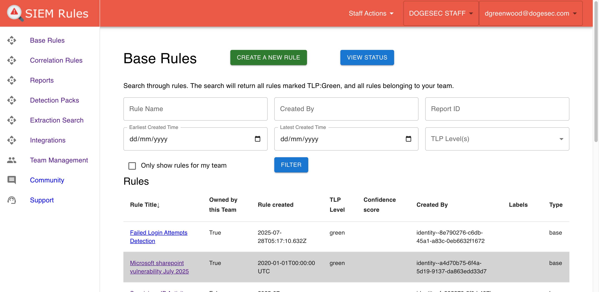
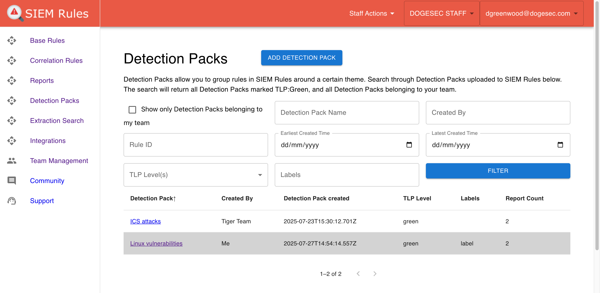
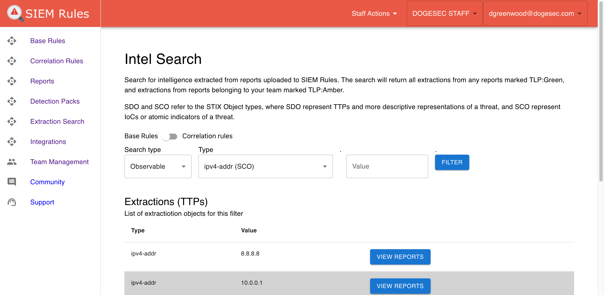

# OpenCTI SIEM Rules Connector

## Overview

SIEM Rules is a web application that turns threat intelligence reports into detection rules.

[You can read more and sign up for SIEM Rules for free here](https://www.siemrules.com/).

The OpenCTI SIEM Rules Connector syncs the detection rules held in SIEM Rules Detection Packs to OpenCTI.

_Note: The OpenCTI SIEM Rules Connector only works with SIEM Rules Web. It does not work with self-hosted SIEM Rules installations at this time._

## Installation

### Prerequisites

* An SIEM Rules team subscribed to a plan with API access enabled
* OpenCTI >= 6.5.10

### Generating an SIEM Rules API Key

1. Log in to your SIEM Rules account and navigate to "Account Settings"
2. Locate the API section and select "Create Token"
3. Select the team you want to use and generate the key
4. Copy the key, it will be needed for the configoration

### Configoration

If you are unfamiliar with how to install OpenCTI Connectors, [you should read the official documentation here](https://docs.opencti.io/latest/deployment/connectors/).

Find all the configuration variables available here: [Connector Configurations](./__metadata__/CONNECTOR_CONFIG_DOC.md).

_The `opencti` and `connector` options in the `docker-compose.yml` and `config.yml` are the same as for any other connector.
For more information regarding variables, please refer to [OpenCTI's documentation on connectors](https://docs.opencti.io/latest/deployment/connectors/)._

Set `CONNECTOR_ID` to a unique UUIDv4 for each deployment.

`SIEMRULES_DETECTION_PACKS` takes a comma-separated list of Detection Pack IDs (e.g. `pack_id1,pack_id2,pack_id3`). You can get a Detection Pack ID in the SIEM Rules web app. At least one Detection Pack ID must be passed: the connector stops at startup when the list is empty. You can use any Detection Pack visible to the authenticated team, even if that team does not own it. All historical intelligence from reports is ingested, and new intelligence added to a Detection Pack is ingested at the interval set by `CONNECTOR_DURATION_PERIOD`.

`SIEMRULES_INTERVAL_HOURS` (`siemrules.interval_hours`) is deprecated: it still works and is converted to `CONNECTOR_DURATION_PERIOD`, but use `CONNECTOR_DURATION_PERIOD` instead.

### Verification

To verify the connector is working, you can navigate to `Data` -> `Ingestion` -> `Connectors` -> `SIEM Rules`.

## Support

You should contact OpenCTI if you are new to installing Connectors and need support.

If you run into issues when installing this Connector, you can reach the dogesec team as follows:

* [dogesec Community Forum](https://community.dogesec.com/) (recommended)
* [dogesec Support Portal](https://support.dogesec.com/) (requires a plan with email support)