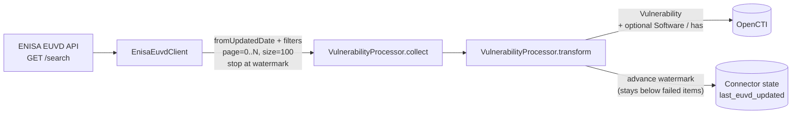

# OpenCTI ENISA EUVD Connector

Table of Contents

- [Introduction](#introduction)
- [Installation](#installation)
  - [Requirements](#requirements)
- [Configuration variables](#configuration-variables)
  - [In-code constants](#in-code-constants)
- [Deployment](#deployment)
  - [Docker Deployment](#docker-deployment)
  - [Manual Deployment](#manual-deployment)
- [Usage](#usage)
- [Behavior](#behavior)
  - [Data flow](#data-flow)
  - [STIX 2.1 mapping](#stix-21-mapping)
  - [Collection strategy and checkpointing](#collection-strategy-and-checkpointing)
- [Known caveats](#known-caveats)
- [Debugging](#debugging)
- [Additional information](#additional-information)

## Introduction

The ENISA EUVD connector imports vulnerability intelligence from the
[European Union Vulnerability Database](https://euvd.enisa.europa.eu/) (EUVD),
the official EU repository for cybersecurity vulnerability intelligence
published by ENISA (European Union Agency for Cybersecurity). See the
[API documentation](https://euvd.enisa.europa.eu/apidoc).

Each vulnerability is ingested as a STIX `Vulnerability` with its CVSS scores
(v2/v3/v4, whichever the source reports), EPSS score, aliases (CVE, GHSA...)
and a label for its assigner. The import can be restricted to a minimum score,
to exploited vulnerabilities or to critical ones. Affected products, with their
vendor, can optionally be ingested as `Software` observables linked to the
vulnerability with a `has` relationship (`ingest_software`).

## Installation

### Requirements

- OpenCTI Platform >= 6.8.12
- No API key: the ENISA EUVD API is public and requires no authentication.

## Configuration variables

Find all the configuration variables available here: [Connector Configurations](./__metadata__/CONNECTOR_CONFIG_DOC.md)

_The `opencti` and `connector` options in the `docker-compose.yml` and `config.yml` are the same as for any other connector.
For more information regarding variables, please refer to [OpenCTI's documentation on connectors](https://docs.opencti.io/latest/deployment/connectors/)._

Set your own `CONNECTOR_ID` (a UUIDv4) before deploying more than one
instance: the default value is shared by every deployment.

### In-code constants

The following are not configurable and are documented here for transparency
(see `src/enisa_euvd/client_api.py`):

| Constant      | Value  | Notes                                                              |
| ------------- | ------ | -------------------------------------------------------------------|
| Page size     | 100    | Maximum page size accepted by `/search` (larger values are capped by the API). |
| Rate limit    | 2/s    | Proactive throttle; ENISA documents no rate limit, so this is defensive. |
| Max retries   | 5      | On 408/429/5xx, with exponential backoff.                          |
| Backoff factor| 2.0    |                                                                      |
| Timeout       | 60s    |                                                                      |
| User-Agent    | `OpenCTI-ENISA-EUVD-Connector/1.0 (+https://github.com/OpenCTI-Platform/connectors)` | |

## Deployment

### Docker Deployment

Copy `docker-compose.yml` and adjust environment variables, then:

```shell
docker compose up -d
```

### Manual Deployment

Copy `config.yml.sample` to `config.yml`, adjust values, then:

```shell
pip install -r src/requirements.txt
python3 src/main.py
```

## Usage

No manual action is required after deployment. The connector runs
automatically according to `duration_period`.

## Behavior

### Data flow



### STIX 2.1 mapping

#### Vulnerability

| Source field | SDK property | Rule |
| --- | --- | --- |
| `id` (`EUVD-xxxx`) | `name` | never empty |
| `description` | `description` | full |
| `datePublished` | `created` | |
| `aliases` (CVE, GHSA...) | `aliases` | split by line, deduplicated |
| `baseScore` + `baseScoreVersion` | `cvss_v{2,3,4}_base_score` | routed by version (`2.0`→v2, `3.0`/`3.1`→v3, `4.0`→v4); unrecognized versions are logged and dropped |
| `baseScoreVector` | `cvss_v{2,3,4}_vector_string` | same routing |
| `epss` | `epss_score` | EUVD gives a percentage (`18.38`), divided by 100 (`0.1838`) |
| `assigner` | `labels` | stripped; no label when blank. Vendors and products are not labels: affected products, with their vendor, are available as `Software` through `ingest_software` |
| `id` | `external_references[]` | `source_name="ENISA EUVD"`, `external_id`, `url=https://euvd.enisa.europa.eu/vulnerability/{id}` |
| `references` (URL lines) | `external_references[]` | one per URL; `source_name` inferred from the domain (NVD, GitHub Advisory...), else `"ENISA EUVD reference"` |

#### Software (opt-in `ingest_software`)

| Source field | SDK property |
| --- | --- |
| `enisaIdProduct[].product.name` | `name` |
| `enisaIdProduct[].product.vendor.name` | `vendor` |
| `enisaIdProduct[].product_version` | `version` |

#### Relationship

| Source | Target | Type | Condition |
| --- | --- | --- | --- |
| Software | Vulnerability | `has` | `ingest_software=true` |

#### Common

- `OrganizationAuthor(name="ENISA")` as `created_by_ref` on every object.
- `TLPMarking(level=tlp_level)` on every object.

#### Not mapped

| Source field | Reason |
| --- | --- |
| `enisaUuid` | Internal technical id, no OpenCTI use. |
| `dateUpdated` | The connectors-sdk `Vulnerability` model has no `modified` property; the date is only used as the collection watermark. |
| `exploitedSince` | No dedicated SDK property; use `exploited_only` to restrict the import to exploited vulnerabilities. |
| Detailed CVSS sub-metrics (AV/AC/PR...) | EUVD only exposes the raw vector string, not individual sub-metric fields. |
| CWE | Absent from the EUVD `/search` payload (verified live). |
| EPSS percentile | Absent from the EUVD payload (only a raw `epss` score is provided). |

### Collection strategy and checkpointing

`GET /search` is sorted **descending by `dateUpdated`** and paginated with
`page`/`size` (max `size=100`). Its `fromUpdatedDate` filter only has day
granularity.

- The connector keeps a single watermark, `last_euvd_updated`, in its
  persisted state: the `dateUpdated` of the newest vulnerability imported.
- On each run, it requests `fromUpdatedDate=<day of the watermark>` (or of
  `import_start_date` on the first run) with the configured `fromScore` and
  `exploited` filters, walks `page=0, 1, 2...`, and stops at the first item
  updated at or before the watermark: everything after it is older.
- The comparison is strict (`>`): the newest item of a run, whose
  `dateUpdated` became the watermark, is not sent again on the next run.
- If an item fails validation or conversion, the watermark stays below it: it
  moves to the newest converted item older than every failed item (or does
  not move), so the failed item is fetched again on the next run. An item
  whose `dateUpdated` itself cannot be read cannot be placed: it is logged and
  skipped.

## Known caveats

- **Vendor-only entries**: a vendor listed in `enisaIdVendor` without a matching
  product is not imported. Vendors only reach OpenCTI as the vendor of an
  ingested `Software`.
- **No resume within a run**: pagination is by position, and new items shift
  every page, so a failed run is not resumed from a partial page. The state
  is only saved after a fully successful run, so the next run walks again
  from `page=0` with the previous watermark. This is safe (deterministic STIX
  ids) but a failure near the end of a large first import (90 days by
  default) sends that whole window again.
- **Item that keeps failing validation or conversion**: the watermark stays below it, so
  every following run sends it and every newer item again until it converts.
  Each failure is logged as a warning with its EUVD id.
- **Changing the filters**: the watermark is not reset when `min_score`,
  `exploited_only` or `critical_only` change. Vulnerabilities newly matching
  a looser filter but updated before the watermark are not imported until
  they are updated again; reset the connector state to import them.
- **CVSS v2 items have no `base_severity`**: EUVD does not provide a severity
  label (only a numeric score), so `cvss_v{2,3,4}_base_severity` is never set.
- **`Software` volume**: a single vulnerability can list many affected
  products; `ingest_software` is off by default to avoid an unbounded number
  of observables per run. Enable it only if you are prepared for the extra
  volume.
- **Unrecognized future CVSS versions**: if ENISA starts reporting a
  `baseScoreVersion` not in `{2.0, 3.0, 3.1, 4.0}`, the score/vector for that
  item is dropped (logged as a warning), not guessed.

## Debugging

Set `CONNECTOR_LOG_LEVEL=debug` to get verbose logs, including every HTTP
request made to the ENISA EUVD API.

## Additional information

Out of scope for this version:

- The `/exploitedvulnerabilities` and `/criticalvulnerabilities` endpoints
  (redundant subsets of `/search`, not separately ingested).
- Parsing individual CVSS sub-metrics (attack vector, privileges required...)
  from the vector string — only the raw score and vector string are stored.
- Unlimited history import — bounded by `import_start_date` on the first run.
