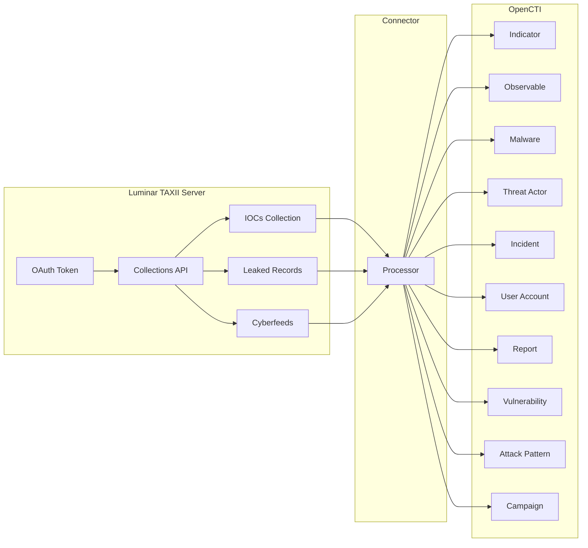

# OpenCTI Luminar CTI Connector

| Status | Date | Comment |
|--------|------|---------|
| Community | -    | -       |

The Luminar connector imports threat intelligence from Cognyte Luminar platform into OpenCTI, including IOCs, leaked credentials, and strategic cyber intelligence feeds.

## Table of Contents

- [Introduction](#introduction)
- [Installation](#installation)
  - [Requirements](#requirements)
- [Configuration variables](#configuration-variables)
  - [OpenCTI environment variables](#opencti-environment-variables)
  - [Base connector environment variables](#base-connector-environment-variables)
  - [Luminar CTI Connector extra parameters](#luminar-cti-connector-extra-parameters)
- [Deployment](#deployment)
  - [Docker Deployment](#docker-deployment)
  - [Manual Deployment](#manual-deployment)
- [Usage](#usage)
- [Behavior](#behavior)
  - [Data Flow](#data-flow)
  - [Entity Mapping](#entity-mapping)
  - [Processing Details](#processing-details)
  - [Relationships Created](#relationships-created)
- [Debugging](#debugging)
- [Additional Information](#additional-information)

---

## Introduction

Cognyte is a global leader in security analytics software that empowers governments and enterprises with Actionable Intelligence. Luminar is Cognyte's asset-based cybersecurity intelligence platform that enables organizations to build and maintain a proactive threat intelligence operation.

This connector integrates with the Luminar TAXII 2 server to import three distinct intelligence feeds:

| Feed Alias      | Description                                                         |
|-----------------|---------------------------------------------------------------------|
| `iocs`          | Indicators of Compromise (IPs, domains, URLs, file hashes)         |
| `leakedrecords` | Leaked credentials and compromise incidents                         |
| `cyberfeeds`    | Strategic intelligence (malware, threat actors, campaigns, reports)|

---

## Installation

### Requirements

| Requirement          | Description                                      |
|----------------------|--------------------------------------------------|
| OpenCTI Platform     | Version 6.7.4 or higher                         |
| Luminar Account      | Active Cognyte Luminar subscription             |
| API Credentials      | Client ID and Client Secret from Luminar        |

---

## Configuration variables

### OpenCTI environment variables

| Parameter     | config.yml | Docker Environment Variable | Mandatory | Description                          |
|---------------|------------|----------------------------|-----------|--------------------------------------|
| OpenCTI URL   | url        | `OPENCTI_URL`              | Yes       | URL of the OpenCTI platform         |
| OpenCTI Token | token      | `OPENCTI_TOKEN`            | Yes       | API token for the OpenCTI platform  |

### Base connector environment variables

| Parameter         | config.yml      | Docker Environment Variable | Default         | Mandatory | Description                                                |
|-------------------|-----------------|-----------------------------|-----------------|-----------|------------------------------------------------------------|
| Connector ID      | id              | `CONNECTOR_ID`              |                 | Yes       | Unique identifier (UUIDv4)                                |
| Connector Type    | type            | `CONNECTOR_TYPE`            | EXTERNAL_IMPORT | Yes       | Must be `EXTERNAL_IMPORT`                                  |
| Connector Name    | name            | `CONNECTOR_NAME`            |                 | Yes       | Name of the connector                                      |
| Connector Scope   | scope           | `CONNECTOR_SCOPE`           |                 | Yes       | Connector scope                                            |
| Log Level         | log_level       | `CONNECTOR_LOG_LEVEL`       | info            | No        | Log verbosity: `debug`, `info`, `warn`, `error`           |
| Duration Period   | duration_period | `CONNECTOR_DURATION_PERIOD` | PT1D            | No        | Interval between runs (ISO 8601 format)                   |

### Luminar CTI Connector extra parameters

| Parameter            | config.yml          | Docker Environment Variable  | Default                      | Mandatory | Description                                   |
|----------------------|---------------------|------------------------------|------------------------------|-----------|-----------------------------------------------|
| Luminar Base URL     | base_url            | `LUMINAR_BASE_URL`           | https://www.cyberluminar.com | Yes       | Luminar API base URL                         |
| Account ID           | account_id          | `LUMINAR_ACCOUNT_ID`         |                              | Yes       | Luminar Account ID                           |
| Client ID            | client_id           | `LUMINAR_CLIENT_ID`          |                              | Yes       | Luminar API Client ID                        |
| Client Secret        | client_secret       | `LUMINAR_CLIENT_SECRET`      |                              | Yes       | Luminar API Client Secret                    |
| Initial Fetch Date   | initial_fetch_date  | `LUMINAR_INITIAL_FETCH_DATE` |                              | Yes       | Start date for import (YYYY-MM-DD format)    |
| Create Observable    | create_observable   | `LUMINAR_CREATE_OBSERVABLE`  | True                         | No        | Create observables from indicators           |
| Mask Credentials     | mask_credentials    | `LUMINAR_MASK_CREDENTIALS`   | False                        | No        | Store leaked credentials masked, keeping only the first and last character (`changeme` → `c******e`) |

---

## Deployment

### Docker Deployment

Build a Docker image using the provided Dockerfile:

```bash
docker build -t opencti/connector-luminar:latest .
```

Example `docker-compose.yml`:

```yaml
version: '3'
services:
  connector-luminar:
    image: opencti/connector-luminar:latest
    environment:
      - OPENCTI_URL=http://localhost:8080
      - OPENCTI_TOKEN=ChangeMe
      - CONNECTOR_ID=ChangeMe
      - CONNECTOR_NAME=Luminar
      - CONNECTOR_SCOPE=luminar
      - CONNECTOR_LOG_LEVEL=info
      - CONNECTOR_DURATION_PERIOD=P1D
      - LUMINAR_BASE_URL=https://www.cyberluminar.com
      - LUMINAR_ACCOUNT_ID=ChangeMe
      - LUMINAR_CLIENT_ID=ChangeMe
      - LUMINAR_CLIENT_SECRET=ChangeMe
      - LUMINAR_INITIAL_FETCH_DATE=2024-01-01
      - LUMINAR_CREATE_OBSERVABLE=true
      - LUMINAR_MASK_CREDENTIALS=false
    restart: always
```

Start the connector:

```bash
docker compose up -d
```

### Manual Deployment

1. Navigate to the connector directory:

```bash
cd external-import/luminar/src
```

2. Install dependencies (in a virtual environment):

```bash
python3 -m venv ../.venv && ../.venv/bin/pip install -r requirements.txt
```

3. Create a `config.yml` from `config.yml.sample` and configure variables
4. Run the connector:

```bash
python3 main.py
```

When the connector runs on the host while OpenCTI runs in Docker, the RabbitMQ
host name advertised by the platform (e.g. `rabbitmq`) is not resolvable from the
host. Publish the AMQP port and set `MQ_HOST` (and `MQ_PORT` if needed), e.g.
`MQ_HOST=localhost python3 main.py`. Set `CONNECTOR_DURATION_PERIOD=0` to run once
and exit.

---

## Usage

After installation, the connector runs automatically at the interval specified by `CONNECTOR_DURATION_PERIOD`. To force an immediate sync:

1. Navigate to **Data management → Ingestion → Connectors** in OpenCTI
2. Find the **Luminar** connector
3. Click the refresh button to reset state and trigger a new poll

---

## Behavior

### Data Flow



### Entity Mapping

The tables list the typical content of each collection. Any supported STIX 2.1 object type found in any collection is ingested (see Processing Details).

#### IOC Collection

| Luminar Data         | OpenCTI Entity Type | Notes                                    |
|----------------------|--------------------|------------------------------------------|
| Malware              | Malware            | Malware family with threat score         |
| Threat Actor         | Threat Actor       | Threat group information                 |
| IP Indicator         | Indicator + IPv4   | IP address IOC with observable           |
| Domain Indicator     | Indicator + Domain | Domain IOC with observable               |
| URL Indicator        | Indicator + URL    | URL IOC with observable                  |
| File Hash Indicator  | Indicator + File   | Hash IOC (MD5, SHA-1, SHA-256)          |
| Email Indicator      | Indicator + Email  | Email address IOC                        |

#### Leaked Records Collection

| Luminar Data         | OpenCTI Entity Type | Notes                                    |
|----------------------|--------------------|------------------------------------------|
| Incident             | Incident           | Compromise incident (severity: high)     |
| Malware              | Malware            | Related malware family                   |
| User Account         | User Account       | Compromised credentials                  |

#### Cyberfeeds Collection

| Luminar Data         | OpenCTI Entity Type | Notes                                    |
|----------------------|--------------------|------------------------------------------|
| Report               | Report             | Intelligence report with object refs     |
| Malware              | Malware            | Malware family details                   |
| Threat Actor         | Threat Actor       | Threat group profile                     |
| Campaign             | Campaign           | Attack campaign                          |
| Vulnerability        | Vulnerability      | CVE information                          |
| Attack Pattern       | Attack Pattern     | MITRE ATT&CK technique                   |
| Tool                 | Tool               | Attacker tool                            |
| Location             | Location           | Geographic targeting                     |
| Identity             | Identity           | Targeted organization                    |

### Processing Details

The connector runs an Extract → Transform → Load pipeline per feed, one bounded
batch at a time (by default 10 TAXII pages per batch); a feed is never loaded
entirely into memory.

1. **Extract** (`luminar_manager.py`):
   - OAuth 2.0 client credentials flow, automatic token refresh on 401
   - TAXII pagination with `next` cursors and `added_after` checkpoints
   - Retries on 429/5xx and network errors; expired cursors (HTTP 410) are rebuilt
     from the last `X-TAXII-Date-Added-Last` header
   - Objects referenced by a batch (`*_ref`/`*_refs`) but delivered in another batch
     are attached to it (neighbouring batches, cache, or `match[id]` lookup), together
     with the objects they reference in turn (author identity, markings, endpoints)

2. **Transform** (`converter_to_stix.py`):
   - Every supported STIX 2.1 object is considered on its own (SDOs, observables,
     relationships, sightings, marking definitions), not only objects linked by a
     relationship. Unsupported types (e.g. `extension-definition`) are skipped and counted.
   - Luminar STIX ids are preserved; objects whose content is identical apart from id
     and timestamps (Luminar issues one id per occurrence, e.g. software "Exploit",
     location `{country: "US"}`) are collapsed to one object per batch with references
     rewritten (relationships and markings are never collapsed)
   - Duplicates within a batch are resolved by `modified`
   - Expired objects are removed (see below), then each object is validated with the
     `stix2` library; a malformed object is skipped without affecting the others
   - Observables are derived from indicator `=` comparisons when `create_observable=true`
     (linked with `based-on`)
   - References are made consistent: relationships/sightings with a missing endpoint are
     dropped, containers keep only resolvable `object_refs` (reports/groupings are kept
     even if none remain), unresolvable markings are
     removed (standard TLP markings are always resolvable), and objects without a
     resolvable author are attributed to "Cognyte Luminar"
   - Relationship types are checked against the connected OpenCTI platform's
     relationship schema (`schemaRelationsTypesMapping`); a type the platform does not
     allow between the two entity types is downgraded to `related-to` (direction is
     never changed)

3. **Expiration filtering** (`expiration.py`):
   - Only indicators expire: an indicator is excluded when `valid_until <= now` (UTC)
   - Indicators without `valid_until` and all other object types never expire
   - `created`/`modified`/`valid_from` are never used to exclude objects

4. **Load** (`connector.py`):
   - One OpenCTI work per run; each batch is sent in three phases (entities and
     markings → relationships/sightings → reports/groupings), each phase only after
     OpenCTI has ingested the previous one (work progress), so referenced objects are
     stored before the objects referencing them (the wait gives up only if ingestion
     makes no progress for 15 minutes)
   - The feed checkpoint is saved after each successfully sent batch, unless a
     referenced-object lookup failed for that batch (the feed then stops and the
     batch is re-read on the next run)

#### Enrichments

| Object | Addition (only when the property is absent) |
|--------|---------------------------------------------|
| Indicator | `x_opencti_score` = Luminar's own indicator `score` (0-100) when provided, else 90 for "Known Malicious IPs", otherwise 80; `description` = name |
| Vulnerability | CVSS v3.x from the Luminar extension → `x_opencti_cvss_base_score`, `x_opencti_cvss_base_severity`, `x_opencti_cvss_vector_string` (other Luminar attributes as labels, see above) |
| Every object | label `luminar.feed:<feed>` (`iocs`, `leakedrecords`, `cyberfeeds`) recording which Luminar feed delivered it; an object delivered by several feeds carries one label per feed (author identity and markings excluded) |
| Any object with Luminar extension attributes | every attribute not mapped natively becomes a label `luminar.<key>:<value>` (key without its `luminar_` prefix; one label per list element; booleans `true`/`false`). Near-unique attributes (`collection_date`, `computer_name`, `resolving_domains`, `url`), long or structured values are appended to the description as a `Luminar attributes:` block instead (labels are entities in OpenCTI; one per unique value would flood the platform). `extension_type` and `luminar_tenant_id` are not exported |
| Incident (leakedrecords) | `source` "Cognyte Luminar", `incident_type` compromise, `severity` high |
| User Account | score 100; **one object per leaked credential**: the Luminar record id is set as `user_id` (OpenCTI identifies User-Accounts by `account_type` + `user_id` + `account_login`, and Luminar often sends placeholder logins such as `[unknown]`); `credential` masked when `mask_credentials` is true |
| Other observables | score 80 |
| Reports, cyberfeeds SDOs | score 80 |
| SDOs | feed-specific default description ("Luminar IOC", "Luminar Leaked Credentials", "Luminar Cyberfeeds") |

### Relationships Created

Relationships delivered by Luminar are ingested as delivered (subject to the schema
check above). The connector itself only creates:

| Source Entity | Relationship Type | Target Entity | Condition |
|---------------|-------------------|---------------|-----------|
| Indicator     | based-on          | Observable    | `create_observable=true` |

### State Management

| State Key      | Description                                                             |
|----------------|-------------------------------------------------------------------------|
| `feeds.<alias>`| `X-TAXII-Date-Added-Last` of the last ingested batch, used as `added_after` |
| `last_run_end` | Time the last run finished (informational)                              |

A legacy `last_run` value is migrated once into every feed checkpoint.

Checkpoints only move forward and are pushed to OpenCTI immediately after each
batch (not only at the next connector ping), so a crash loses no ingested progress.
Luminar does not return objects strictly ordered by `date_added` (sub-millisecond
inversions were measured), so a feed resumes from its checkpoint minus 1 second;
re-delivered objects are upserted by OpenCTI.

Note: OpenCTI only stores attributes of its own schema. Luminar extension fields
are therefore exported as `luminar.<key>:<value>` labels or a description block
(see Enrichments); see `CHANGELOG_IMPLEMENTATION.md` for the coverage analysis.

---

## Debugging

### Common Issues

| Issue                     | Solution                                                    |
|---------------------------|-------------------------------------------------------------|
| Authentication failed     | Verify Client ID, Client Secret, and Account ID            |
| No collections found      | Check API credentials have proper permissions               |
| Empty data                | Verify `LUMINAR_INITIAL_FETCH_DATE` is not in the future   |
| Token expired             | Connector handles automatic refresh; check credentials      |

### Logging

Enable detailed logging by setting `CONNECTOR_LOG_LEVEL=debug`.

### HTTP Status Codes

| Code | Meaning                                                      |
|------|--------------------------------------------------------------|
| 400  | Bad request - check query parameters                         |
| 401  | Unauthorized - credentials issue (triggers token refresh)    |
| 403  | Forbidden - insufficient permissions                         |
| 429  | Rate limited - reduce polling frequency                      |

---

## Additional Information

### About Cognyte Luminar

Luminar provides:
- Real-time IOC feeds from deep/dark web monitoring
- Leaked credential detection
- Strategic threat intelligence
- MITRE ATT&CK mapping

### Resources

- [Cognyte Website](https://www.cognyte.com/)
- [Luminar Platform](https://www.cyberluminar.com/)
- [OpenCTI Documentation](https://docs.opencti.io/)

### Scoring

The connector applies an `x_opencti_score` of:
- **90**: For "Known Malicious IPs" indicators
- **80**: For all other entities
- **100**: For compromised user accounts
