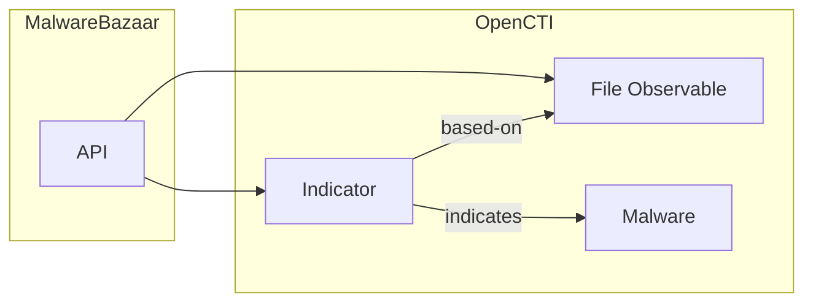

# OpenCTI MalwareBazaar Connector

| Status | Date | Comment |
|--------|------|---------|
| Verified | - | - |

The MalwareBazaar connector imports malware samples and their hashes from abuse.ch MalwareBazaar into OpenCTI.

## Table of Contents

- [OpenCTI MalwareBazaar Connector](#opencti-malwarebazaar-connector)
  - [Table of Contents](#table-of-contents)
  - [Introduction](#introduction)
  - [Installation](#installation)
    - [Requirements](#requirements)
  - [Configuration variables](#configuration-variables)
    - [OpenCTI environment variables](#opencti-environment-variables)
    - [Base connector environment variables](#base-connector-environment-variables)
    - [Connector extra parameters environment variables](#connector-extra-parameters-environment-variables)
  - [Authentication](#authentication)
  - [Deployment](#deployment)
    - [Docker Deployment](#docker-deployment)
    - [Manual Deployment](#manual-deployment)
  - [Usage](#usage)
  - [Behavior](#behavior)
  - [Debugging](#debugging)
  - [Additional information](#additional-information)

## Introduction

MalwareBazaar is a project from abuse.ch with the goal of sharing malware samples with the infosec community, AV vendors, and threat intelligence providers. The platform collects malware samples submitted by security researchers and organizations.

This connector fetches recent malware sample metadata from MalwareBazaar API and imports them as File observables with associated hashes (MD5, SHA-1, SHA-256), along with a related Indicator and, when available, the detected Malware family, into OpenCTI.

## Installation

### Requirements

- OpenCTI Platform >= 6.x
- One of the two authentication modes described in [Authentication](#authentication):
  - an abuse.ch Auth-Key (free, from [auth.abuse.ch](https://auth.abuse.ch)), or
  - the username and password of a Spamhaus abuse.ch API account (commercial API, from the Spamhaus Customer Portal)

## Configuration variables

Find all the configuration variables available here: [Connector Configurations](./__metadata__/CONNECTOR_CONFIG_DOC.md)

_The `opencti` and `connector` options in the `docker-compose.yml` and `config.yml` are the same as for any other connector.
For more information regarding variables, please refer to [OpenCTI's documentation on connectors](https://docs.opencti.io/latest/deployment/connectors/)._

### Authentication

The connector supports two authentication modes. At least one must be configured, otherwise it refuses to start
with a message naming both options.

| Mode | Variables | Host | Notes |
|------|-----------|------|-------|
| Community | `MALWAREBAZAAR_AUTH_KEY` | `mb-api.abuse.ch` (`MALWAREBAZAAR_API_BASE_URL`) | `Auth-Key` header, unchanged. Daily limits of the community API apply. `MALWAREBAZAAR_API_KEY` is the deprecated former name and is still accepted. |
| Commercial | `MALWAREBAZAAR_SPAMHAUS_USERNAME` and `MALWAREBAZAAR_SPAMHAUS_PASSWORD` | `api.spamhaus.com` | Username and password of a Spamhaus abuse.ch API account. No daily export limit. |

- **Both modes set**: the commercial mode is used first. If it cannot be used (credentials rejected, network error,
  HTTP 5xx), the connector logs a warning and falls back to the community Auth-Key for that run.
- **Commercial credentials only**: if they fail, the run fails and the work is closed in error with a message asking
  to check the Spamhaus credentials.
- **Token handling**: the connector logs in once (`POST https://api.spamhaus.com/v1/login`, realm `abusech`), reuses
  the JWT until shortly before it expires (24 hours), and logs in again once when the API answers HTTP 401.
- **Secrets**: the password, the JWT and the login response are never written to the logs or to the work messages.
- **User-Agent**: every request sends `OpenCTI-malwarebazaar/<version>`; Spamhaus rejects the default Python one.

With the commercial API the connector asks `GET /malwarebazaar/v1/samples` for the samples added since the last
successful run and follows every page of results. On the first run, with no checkpoint yet, it looks back
`MALWAREBAZAAR_SPAMHAUS_INITIAL_LOOKBACK` (default `PT1H`). The community API has no such parameter: it returns the
samples added in the last 60 minutes.

## Deployment

### Docker Deployment

Build the Docker image:

```bash
docker build -t opencti/connector-malwarebazaar:latest .
```

Configure the connector in `docker-compose.yml`:

```yaml
  connector-malwarebazaar:
    image: opencti/connector-malwarebazaar:latest
    environment:
      - OPENCTI_URL=http://localhost
      - OPENCTI_TOKEN=ChangeMe
      - CONNECTOR_ID=ChangeMe
      - CONNECTOR_NAME=MalwareBazaar
      - CONNECTOR_SCOPE=StixFile
      - CONNECTOR_LOG_LEVEL=info
      - CONNECTOR_DURATION_PERIOD=PT50M
      - MALWAREBAZAAR_API_BASE_URL=https://mb-api.abuse.ch/api/v1/
      # Authentication: set the community Auth-Key, the Spamhaus credentials, or both.
      - MALWAREBAZAAR_AUTH_KEY=ChangeMe # Community mode
      # - MALWAREBAZAAR_SPAMHAUS_USERNAME=ChangeMe # Commercial mode
      # - MALWAREBAZAAR_SPAMHAUS_PASSWORD=ChangeMe # Commercial mode
      - MALWAREBAZAAR_TLP_LEVEL=clear
      - MALWAREBAZAAR_X_OPENCTI_SCORE=100
      - MALWAREBAZAAR_INCLUDE_TAGS=exe,dll,docm,docx,doc,xls,xlsx,xlsm,js
      - MALWAREBAZAAR_INCLUDE_REPORTERS=
      - MALWAREBAZAAR_LABELS=malware-bazaar
    restart: always
```

Start the connector:

```bash
docker compose up -d
```

### Manual Deployment

1. Create `config.yml` based on `config.yml.sample`.

2. Install dependencies:

```bash
pip3 install -r requirements.txt
```

3. Start the connector from the `src` directory:

```bash
python3 main.py
```

## Usage

The connector runs automatically at the interval defined by `CONNECTOR_DURATION_PERIOD`. To force an immediate run:

**Data Management → Ingestion → Connectors**

Find the connector and click the refresh button to reset the state and trigger a new sync.

## Behavior

The connector queries the MalwareBazaar API (community or Spamhaus commercial API, see [Authentication](#authentication)) for recent samples and imports them as File observables. Both APIs are mapped to the same entities; fields the commercial API leaves out (such as `tags` or `signature`) are simply not set.

### Data Flow



### Entity Mapping

| MalwareBazaar Data   | OpenCTI Entity/Property | Description                                      |
|----------------------|-------------------------|--------------------------------------------------|
| sha256_hash          | File.hashes.SHA-256     | SHA-256 hash                                     |
| sha1_hash            | File.hashes.SHA-1       | SHA-1 hash                                       |
| md5_hash             | File.hashes.MD5         | MD5 hash                                         |
| file_name            | File.name               | Original filename                                |
| file_size            | File.size               | File size in bytes                               |
| file_type_mime       | File.mime_type          | MIME type                                        |
| sha256_hash          | Indicator               | STIX indicator based on the SHA-256 hash         |
| signature            | Malware                 | Detected malware family                          |
| sha256_hash          | External Reference      | Link to the MalwareBazaar sample page            |
| tags                 | Labels                  | MalwareBazaar tags                               |
| reporter             | Description             | Sample submitter                                 |

### Processing Details

1. **File Observable**: Created with:
   - Multiple hashes (MD5, SHA-1, SHA-256)
   - `x_opencti_score`: Default 100 (high confidence)
   - Labels from configuration
   - TLP marking
   - External reference to the MalwareBazaar sample page

2. **Indicator**: A STIX indicator is created from the SHA-256 hash, linked to the File
   observable with a `based-on` relationship, and carries the same TLP marking and an
   external reference to the MalwareBazaar sample page.

3. **Malware**: If a signature (malware family) is available, a Malware entity is created
   and linked to the Indicator with an `indicates` relationship.

### Filtering Options

- **By Tags**: Filter samples by file type tags (exe, dll, doc, etc.)
- **By Reporter**: Filter samples by submitter name

## Debugging

Enable verbose logging:

```env
CONNECTOR_LOG_LEVEL=debug
```

## Additional information

- **Authentication Required**: an abuse.ch Auth-Key ([auth.abuse.ch](https://auth.abuse.ch)) or Spamhaus API account credentials, see [Authentication](#authentication)
- **High Confidence**: Default score of 100 reflects confirmed malware samples
- **Sample Volume**: MalwareBazaar receives many samples daily; use tag filtering to manage volume
- **Reference**: [MalwareBazaar](https://bazaar.abuse.ch/)
