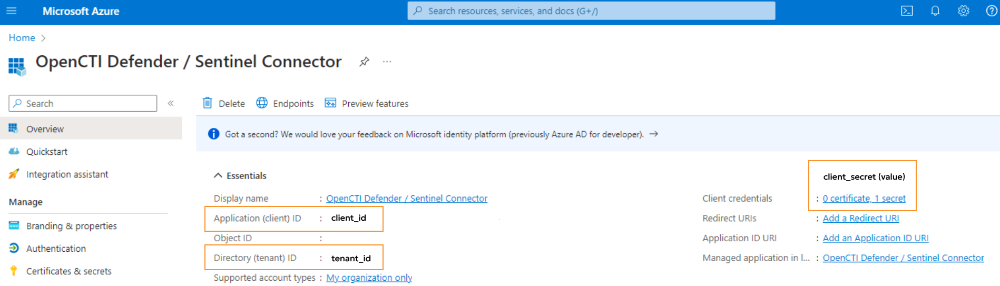
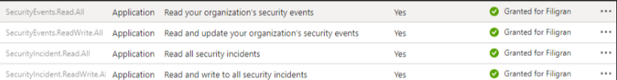

# OpenCTI Microsoft Defender Incidents Connector

| Status | Date | Comment |
|--------|------|---------|
| Filigran Verified | -    | -       |

## Table of Contents

- [OpenCTI Microsoft Defender Incidents Connector](#opencti-microsoft-defender-incidents-connector)
    - [Introduction](#introduction)
    - [Installation](#installation)
        - [Requirements](#requirements)
    - [Configuration variables](#configuration-variables)
    - [Deployment](#deployment)
        - [Docker Deployment](#docker-deployment)
        - [Manual Deployment](#manual-deployment)
    - [Usage](#usage)
    - [Behavior](#behavior)
    - [Debugging](#debugging)
    - [Additional information](#additional-information)

## Introduction

This OpenCTI connector allows to import indicators and observables from Microsoft Defender's incidents to your OpenCTI
platform.

## Installation

If you don't know how to get the `tenant_id`, `client_id`, and `client_secret` information, here's a screenshot to
help !


It's also important to define the necessary permissions in Defender for the connector to work.

In the Microsoft Entra portal, you need to set :  
Home > Application Registration > OpenCTI (your name) > API Permissions  
and enable the permissions named :

- "SecurityIncident.Read.All"
- "SecurityAlert.Read.All"
- "SecurityEvent.Read.All"



For more information, visit:

- [Microsoft Security-Authorization](https://learn.microsoft.com/en-us/graph/security-authorization)

Another interesting link:

- [Microsoft Defender-Threat-Intelligence](https://learn.microsoft.com/en-us/azure/architecture/example-scenario/data/defender-threat-intelligence#import-threat-indicators-with-the-platforms-data-connector)

### Requirements

- OpenCTI Platform >= 6.4

## Configuration variables

Find all the configuration variables available here: [Connector Configurations](./__metadata__/CONNECTOR_CONFIG_DOC.md)

_The `opencti` and `connector` options in the `docker-compose.yml` and `config.yml` are the same as for any other connector.
For more information regarding variables, please refer to [OpenCTI's documentation on connectors](https://docs.opencti.io/latest/deployment/connectors/)._


## Deployment

### Docker Deployment

Before building the Docker container, you need to set the version of pycti in `requirements.txt` equal to whatever
version of OpenCTI you're running. Example, `pycti==6.3.4`. If you don't, it will take the latest version, but
sometimes the OpenCTI SDK fails to initialize.

Build a Docker Image using the provided `Dockerfile`.

Example:

```shell
# Replace the IMAGE NAME with the appropriate value
docker build . -t [IMAGE NAME]:latest
```

Make sure to replace the environment variables in `docker-compose.yml` with the appropriate configurations for your
environment. Then, start the docker container with the provided docker-compose.yml

```shell
docker compose up -d
# -d for detached
```

### Manual Deployment

Create a file `config.yml` based on the provided `config.yml.sample`.

Replace the configuration variables (especially the "**ChangeMe**" variables) with the appropriate configurations for
you environment.

Install the required python dependencies (preferably in a virtual environment):

```shell
pip3 install -r requirements.txt
```

Then, start the connector from recorded-future/src:

```shell
python3 main.py
```

## Usage

After Installation, the connector should require minimal interaction to use, and should update automatically at a
regular interval specified in your `docker-compose.yml` or `config.yml` in `duration_period`.

However, if you would like to force an immediate download of a new batch of entities, navigate to:

`Data management` -> `Ingestion` -> `Connectors` in the OpenCTI platform.

Find the connector, and click on the refresh button to reset the connector's state and force a new
download of data by re-running the connector.

## Behavior

### Defender incident status, classification and determination

Each Defender incident becomes a Case-Incident whose id is derived from the incident name and creation date, so
every Defender update re-fetched by the connector upserts the same Case-Incident.

- **Labels**: when present, the incident's `status`, `classification` and `determination` are added as labels
  `defender-status:<value>`, `defender-classification:<value>` and `defender-determination:<value>` (values
  lower-cased as Defender returns them, e.g. `defender-classification:truepositive`).
- **Description**: the description carries one structured line with the status, classification, determination and
  `assignedTo` of the incident. `assignedTo` is not mapped to a participant: Defender returns a free-text account
  that cannot be matched reliably to an OpenCTI user.
- **Workflow status (optional)**: set `MICROSOFT_DEFENDER_INCIDENTS_STATUS_MAPPING` to map Defender statuses
  (`active`, `inProgress`, `resolved`, `redirected`, `awaitingAction`) to Case-Incident workflow statuses, by status
  name or id, e.g. `active:NEW,inProgress:IN_PROGRESS,awaitingAction:IN_PROGRESS,resolved:CLOSED,redirected:CLOSED`.
  Names are resolved once per run against the statuses of the Case-Incident workflow (Settings > Customization >
  Case-Incident); a name with no matching status is logged as a warning and ignored. When the incident's status is
  mapped, the Case-Incident is sent with that workflow status; an unmapped status leaves the workflow status as it
  is. Without a mapping (the default) no workflow status is sent. The upsert changes the workflow status of an
  existing Case-Incident only when the connector's user confidence level is at least the Case-Incident's confidence;
  a Case-Incident edited by an analyst with a higher confidence keeps its workflow status. Unknown Defender values
  (e.g. `unknownFutureValue`) are left unmapped.
- **Case-Incident confidence**: the connector sends no `confidence`. On creation the platform sets it to the
  connector user's effective max confidence level (the user's own level, else the highest level of its groups, or the
  Case-Incident override of that level when one is set; 100 for a user with the bypass capability). On upsert a
  missing confidence keeps the existing one. To change it, set the max confidence level of the connector's user or
  group (Settings > Security), or a Case-Incident override of it. The same level decides the upsert condition above.
- **Workflow statuses required**: the mapping only works when the Case-Incident type has workflow statuses defined
  in Settings > Customization > Case-Incident. With none, names resolve to nothing (a warning per name) and no
  status is sent. When statuses exist, a Case-Incident created without a mapped status gets the type's first status,
  a mapped id that is not a Case-Incident status is replaced by that first status on creation and dropped on upsert.
- **Rights**: no capability beyond the connector's standard role (create and update knowledge) is needed to set
  `x_opencti_workflow_id` on create or upsert. The platform checks no capability on that field for Case-Incident;
  its only status-write guards apply to the request access workflow of Case-RFI. The user's max confidence level
  is the only condition on upsert.

Note on labels after a status change: the platform upsert adds labels to the existing ones, it does not replace
them. A Case-Incident that moved from `active` to `resolved` in Defender keeps `defender-status:active` next to
`defender-status:resolved`. Use the workflow status (with a mapping) as the current state; the
`defender-status:*` labels record every status the incident went through.

## Debugging

The connector can be debugged by setting the appropiate log level.
Note that logging messages can be added using `self.helper.connector_logger,{LOG_LEVEL}("Sample message")`, i.
e., `self.helper.connector_logger.error("An error message")`.
