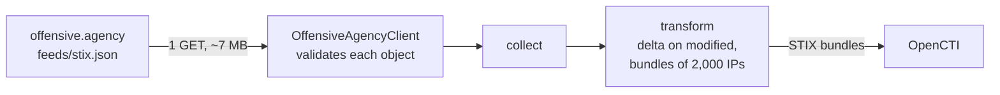

# OpenCTI Offensive Agency Connector

Imports the [offensive.agency](https://www.offensive.agency) feed of Internet-exposed
offensive AI agents into OpenCTI.

Table of Contents

- [OpenCTI Offensive Agency Connector](#opencti-offensive-agency-connector)
  - [Introduction](#introduction)
  - [Installation](#installation)
    - [Requirements](#requirements)
  - [Configuration variables](#configuration-variables)
  - [Deployment](#deployment)
    - [Docker Deployment](#docker-deployment)
    - [Manual Deployment](#manual-deployment)
  - [Usage](#usage)
  - [Behavior](#behavior)
    - [Data flow](#data-flow)
    - [STIX 2.1 mapping](#stix-21-mapping)
    - [Incremental runs](#incremental-runs)
  - [Known caveats](#known-caveats)
  - [Debugging](#debugging)
  - [Additional information](#additional-information)

## Introduction

offensive.agency publishes a free STIX 2.1 feed of offensive AI agents (autonomous
pentest and exploitation agents such as AIDA, HexStrike AI or PentAGI) whose consoles
are exposed on the Internet, based on [ONYPHE](https://www.onyphe.io) scans. The feed
covers the last 7 days and is updated daily.

The connector imports each exposed instance as an IPv4 indicator, linked to the agents
it runs (tools), and optionally creates the IPv4 observables. It helps track this
emerging infrastructure and use it for detection.

## Installation

### Requirements

- OpenCTI Platform >= 6.8.12
- Outbound HTTPS access to `www.offensive.agency`
- No API key: the feed is public

## Configuration variables

The exhaustive, generated list of every parameter is available in
[Connector Configurations](./__metadata__/CONNECTOR_CONFIG_DOC.md).

The connector-specific parameters are:

| Parameter (`config.yml`) | Environment variable | Default | Description |
| --- | --- | --- | --- |
| `offensive_agency.api_base_url` | `OFFENSIVE_AGENCY_API_BASE_URL` | `https://www.offensive.agency/api/v1` | Base URL of the API; the feed is read at `<api_base_url>/feeds/stix.json` |
| `offensive_agency.tlp_level` | `OFFENSIVE_AGENCY_TLP_LEVEL` | `clear` | TLP marking applied to every object (`clear`, `white`, `green`, `amber`, `amber+strict`, `red`) |
| `offensive_agency.indicator_validity` | `OFFENSIVE_AGENCY_INDICATOR_VALIDITY` | `P30D` | Validity of an indicator after the feed last saw it (ISO 8601 duration, minimum `P1D`) |
| `offensive_agency.create_observables` | `OFFENSIVE_AGENCY_CREATE_OBSERVABLES` | `true` | Create IPv4 observables with `based-on` relationships |

The connector defaults are `CONNECTOR_NAME=Offensive Agency`,
`CONNECTOR_SCOPE=Indicator,Tool,IPv4-Addr` and `CONNECTOR_DURATION_PERIOD=PT6H`.

In-code constants (`src/offensive_agency_client/api_client.py` and
`src/connector/data_processors/feed_processor.py`):

- request timeout: 180 seconds (the feed is about 7 MB);
- retries: 3, with exponential backoff (factor 1) on 408, 429 and 5xx responses
  (`connectors-sdk` defaults);
- User-Agent: `OpenCTI-connector-offensive-agency`;
- indicators per bundle: 2,000 (about 8,000 objects per bundle).

## Deployment

### Docker Deployment

Use the image `opencti/connector-offensive-agency`, or build it from the `Dockerfile`:

```shell
docker build . -t opencti/connector-offensive-agency:latest
```

Set at least `OPENCTI_URL`, `OPENCTI_TOKEN` and `CONNECTOR_ID` (a UUIDv4) in
`docker-compose.yml`, then start the container:

```shell
docker compose up -d
```

### Manual Deployment

Create `config.yml` from `config.yml.sample` and replace the `ChangeMe` values. Install the
dependencies, preferably in a virtual environment, then start the connector from `src`:

```shell
pip3 install -r src/requirements.txt
cd src && python3 main.py
```

## Usage

The connector runs every `CONNECTOR_DURATION_PERIOD`. To import the whole feed again, go to
`Data management` -> `Ingestion` -> `Connectors`, open the connector and reset its state.

## Behavior

### Data flow



### STIX 2.1 mapping

| Feed object | OpenCTI object | Mapped fields |
| --- | --- | --- |
| `identity` | Organization `offensive.agency` (author of every object) | Fixed name, description crediting ONYPHE and offensive.agency |
| `tool` | Tool | `name`, `description`, `tool_types`, `external_references`, `created` |
| `indicator` | Indicator | Name = the IP; `pattern` (`[ipv4-addr:value = '<ip>']`), main observable type `IPv4-Addr`, `description`, `indicator_types`, `labels` (`agent:*`, `network:*`, `co-hosted-c2`), `valid_from`, `created`, `external_references`; `valid_until` = `modified` + `indicator_validity` |
| (from the indicator) | IPv4-Addr observable | `value`, `description`, `labels`, `external_references` (when `create_observables` is `true`) |
| (from the indicator) | Relationship `based-on` | Indicator -> observable (when `create_observables` is `true`) |
| `relationship` `indicates` | Relationship `indicates` | Indicator -> tool, `created` |

Every object carries the author and the configured TLP marking.

Not mapped:

- the STIX IDs of the feed: the connector computes deterministic IDs (indicator from its
  pattern, tool from its name), so an indicator or a tool already known from another
  source is updated rather than duplicated;
- the feed `identity` object, replaced by the connector author;
- the indicator `confidence` (85 or 50): `connectors-sdk` models cannot set it yet, so
  OpenCTI applies the confidence level of the connector's user;
- the indicator `name` (it names one agent while an IP can run several).

### Incremental runs

The connector stores in its state the most recent `modified` date sent. The next run only
sends the indicators modified on or after that date, with their relationships, the tools
and the author. The feed is dated by day, so the indicators of the current day are sent
again on every run of that day: OpenCTI updates them without creating duplicates.

A feed object that fails validation (missing field, unsupported pattern, invalid IP) is
skipped with a warning; the rest of the feed is imported.

## Known caveats

- The feed only keeps 7 days. An IP that leaves the feed is not revoked: it expires
  in OpenCTI `indicator_validity` after the feed last saw it.
- The state is saved at the end of a run. If a run fails after some bundles were sent,
  the next run sends them again (no duplicates).
- If the connector stops for more than 7 days, the indicators that entered and left the
  feed meanwhile are never imported.
- Tools are identified by name: a Tool with the same name already in OpenCTI is the same
  object.

## Debugging

Set `CONNECTOR_LOG_LEVEL=debug` to log each run step (feed download, number of
indicators to send, bundles sent). Skipped feed objects are logged at `warning` level
with their ID and the reason.

## Additional information

Data by ONYPHE (https://www.onyphe.io), published by offensive.agency. Free to use,
please credit both if you redistribute it.

Out of scope for this version: IPv6 and non-IP indicators (the feed has none) and the
per-indicator confidence.
