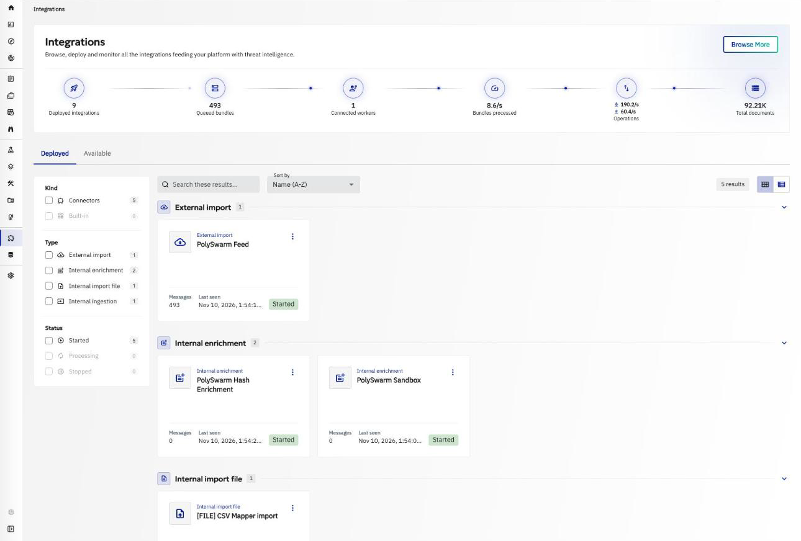
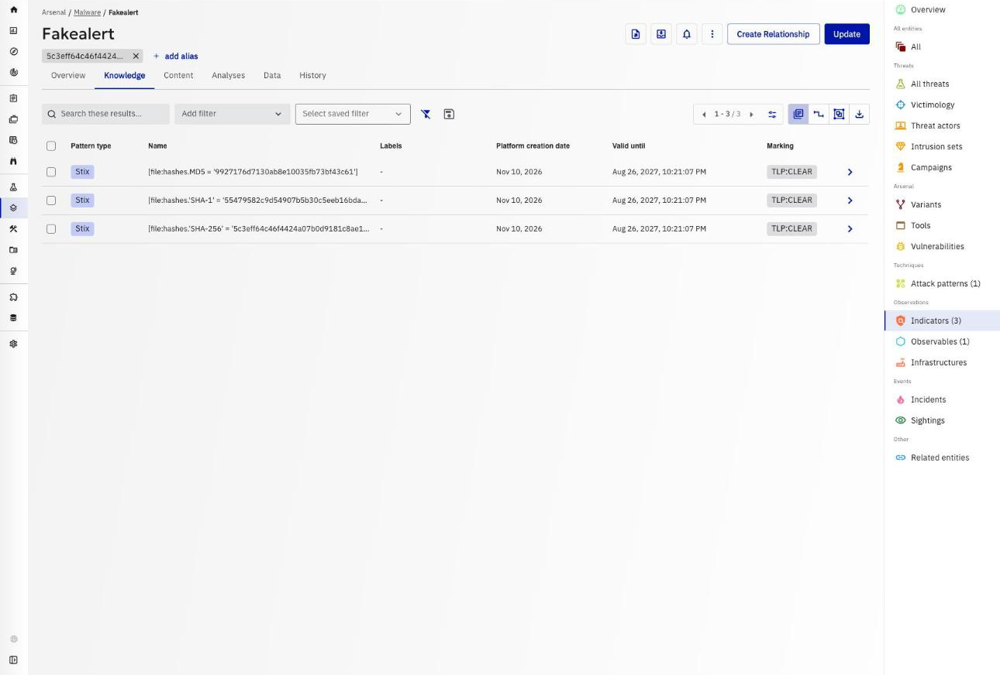
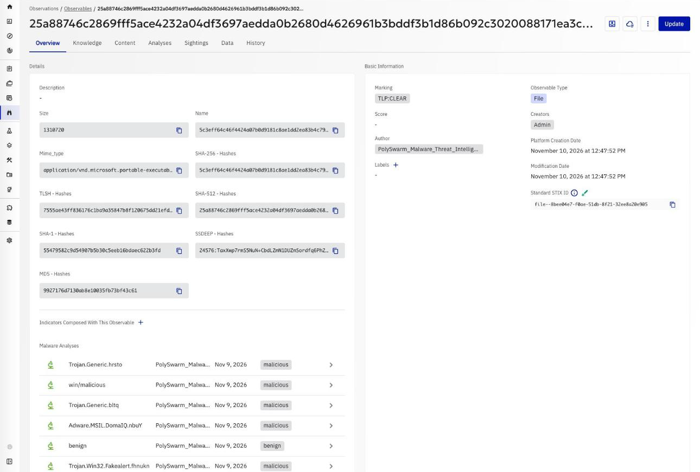
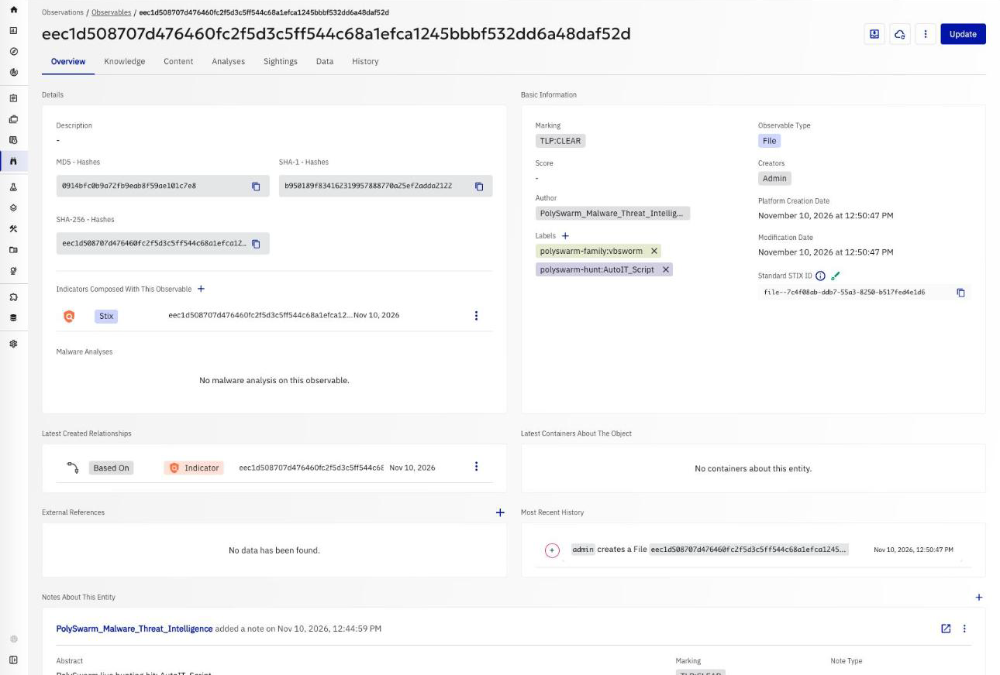
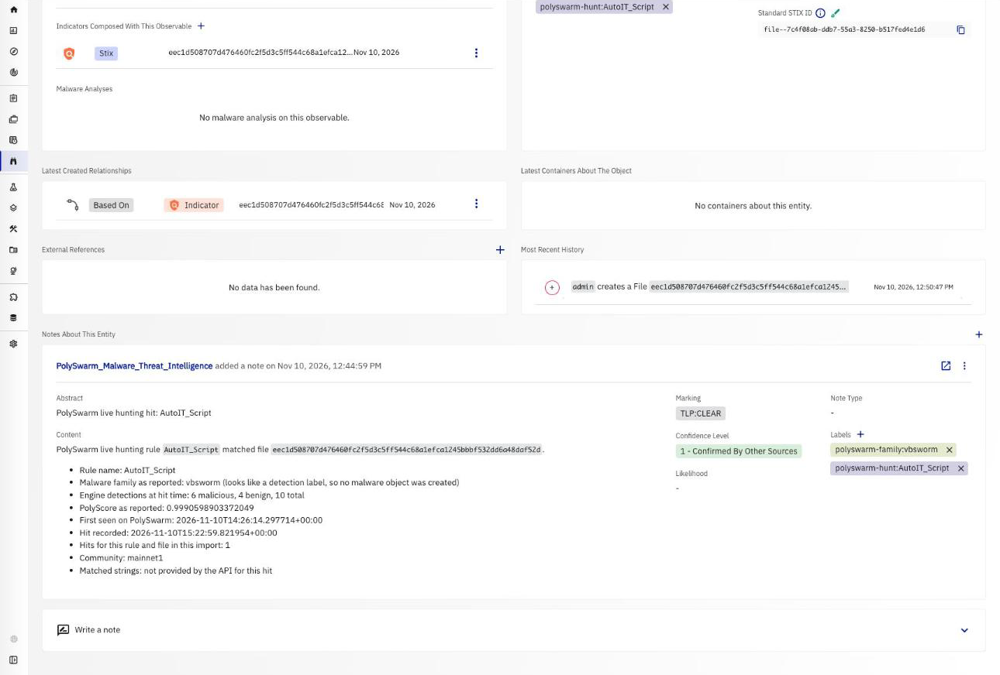

# OpenCTI PolySwarm Feed Connector

This external-import connector imports [PolySwarm](https://polyswarm.io/)'s curated malware file-hash feed into OpenCTI. It runs on a schedule, pulls new data from PolySwarm, and creates STIX 2.1 objects in your platform.

## Table of Contents

- [Introduction](#introduction)
- [Data Handling: What Leaves Your Environment](#data-handling-what-leaves-your-environment)
- [Installation](#installation)
  - [Requirements](#requirements)
- [Configuration variables](#configuration-variables)
- [Deployment](#deployment)
  - [Docker Deployment](#docker-deployment)
  - [Manual Deployment](#manual-deployment)
- [Behavior](#behavior)
  - [Feed collections](#feed-collections)
  - [Objects created per sample](#objects-created-per-sample)
  - [Live hunting hits](#live-hunting-hits)
  - [Indicator lifetime](#indicator-lifetime)
  - [State and resuming](#state-and-resuming)
  - [Volume](#volume)
  - [Quota](#quota)
- [Troubleshooting](#troubleshooting)

## Introduction

The connector reads PolySwarm's STIX 2.1 feed over TAXII and, optionally, the hits from your own PolySwarm live hunts.

What it imports:

- **The 14-day trust group feed** (the `trustgroup` collection), on by default.
- **The ransomware and freemium collections**, which you can add with `POLYSWARM_FEED_COLLECTIONS`.
- **Live hunting hits** from the live hunts in your own PolySwarm account. This is off by default (`POLYSWARM_HUNTING_ENABLED=false`).

All indicators are file hashes (MD5, SHA-1, SHA-256). The connector does not create network indicators (domains, IP addresses, URLs).

## Data Handling: What Leaves Your Environment

The connector only pulls data.

- **Nothing from OpenCTI is sent to PolySwarm.** No observables, entities, reports, markings or users are uploaded, and the connector never submits files for scanning.
- **Where requests go.** Outbound calls go to the PolySwarm API URL only (`POLYSWARM_API_URL`, default `https://api.polyswarm.network`).
- **Account quota.** About once an hour, the connector reads your account's plan and quotas from the same API URL. Only your API key is sent.
- **What is sent with each request.** Your PolySwarm account number and API key, for authentication, plus the paging and time-range parameters needed to ask for new data.

## Installation

### Requirements

- OpenCTI Platform >= 6.8.12
- A PolySwarm account with access to the feed collections you want to import
- Your PolySwarm account number and API key
- Network access from the connector to the PolySwarm API URL

## Configuration variables

Configuration can be given in `config.yml` (copy `config.yml.sample`) or as environment variables. Environment variables take precedence.

### OpenCTI environment variables

| Parameter     | config.yml | Docker environment variable | Mandatory | Description                                  |
|---------------|------------|-----------------------------|-----------|----------------------------------------------|
| OpenCTI URL   | `url`      | `OPENCTI_URL`               | Yes       | The URL of the OpenCTI platform.             |
| OpenCTI Token | `token`    | `OPENCTI_TOKEN`             | Yes       | The token of the user the connector runs as. |

### Base connector environment variables

| Parameter       | config.yml        | Docker environment variable | Default                                                                    | Mandatory | Description                                |
|-----------------|-------------------|-----------------------------|----------------------------------------------------------------------------|-----------|--------------------------------------------|
| Connector ID    | `id`              | `CONNECTOR_ID`              |                                                                            | Yes       | A unique `UUIDv4` for this connector.      |
| Connector Name  | `name`            | `CONNECTOR_NAME`            | `PolySwarm Feed`                                                           | No        | Name shown in OpenCTI.                     |
| Connector Scope | `scope`           | `CONNECTOR_SCOPE`           | `Malware,Indicator,StixFile,Malware-Analysis,Attack-Pattern,Note` | No        | The object types the connector imports.    |
| Log Level       | `log_level`       | `CONNECTOR_LOG_LEVEL`       | `info`                                                                     | No        | `debug`, `info`, `warn` or `error`.        |
| Duration Period | `duration_period` | `CONNECTOR_DURATION_PERIOD` | `PT1H`                                                                     | No        | Time between two runs, in ISO-8601 format. |

### PolySwarm environment variables

| Parameter                    | config.yml                     | Docker environment variable              | Default                         | Mandatory | Description                                                                                                                         |
|------------------------------|--------------------------------|------------------------------------------|---------------------------------|-----------|-------------------------------------------------------------------------------------------------------------------------------------|
| API key                      | `api_key`                      | `POLYSWARM_API_KEY`                      |                                 | Yes       | Your PolySwarm API key.                                                                                                             |
| Account number               | `account_number`               | `POLYSWARM_ACCOUNT_NUMBER`               |                                 | Yes       | Your PolySwarm account number. Used as the user name for the feed (TAXII) login.                                                    |
| API URL                      | `api_url`                      | `POLYSWARM_API_URL`                      | `https://api.polyswarm.network` | No        | Base URL of the PolySwarm API. Must use https.                                                                                                      |
| Feed collections             | `feed_collections`             | `POLYSWARM_FEED_COLLECTIONS`             | `trustgroup`                    | No        | Comma-separated list of collections to import. Allowed values: `trustgroup`, `ransomware`, `freemium`. Unknown values are rejected. |
| Feed backfill days           | `feed_backfill_days`           | `POLYSWARM_FEED_BACKFILL_DAYS`           | `14`                            | No        | How many days of feed history to import on the first run only.                                                                      |
| Feed indicator valid days    | `feed_indicator_valid_days`    | `POLYSWARM_FEED_INDICATOR_VALID_DAYS`    | `90`                            | No        | Days from import time until feed indicators expire (`valid_until`).                                                                 |
| Feed families | `feed_families` | `POLYSWARM_FEED_FAMILIES` |  | No | Comma-separated family names. When set, only feed samples of these families are imported. Case is ignored. Empty means no filtering. |
| Feed excluded families | `feed_exclude_families` | `POLYSWARM_FEED_EXCLUDE_FAMILIES` |  | No | Comma-separated family names. Feed samples of these families are skipped. Case is ignored. Wins over the list above. |
| Feed minimum confidence | `feed_min_confidence` | `POLYSWARM_FEED_MIN_CONFIDENCE` |  | No | Whole number from 0 to 100. Feed samples whose malware confidence is lower are skipped. Samples without a confidence are kept. Empty means no filtering. |
| Hunting enabled             | `hunting_enabled`              | `POLYSWARM_HUNTING_ENABLED`              | `false`                         | No        | Import hits from your own PolySwarm live hunts.                                                                                     |
| Hunting backfill hours       | `hunting_backfill_hours`       | `POLYSWARM_HUNTING_BACKFILL_HOURS`       | `24`                            | No        | How many hours of hunting hits to import on the first run only.                                                                     |
| Hunting indicator valid days | `hunting_indicator_valid_days` | `POLYSWARM_HUNTING_INDICATOR_VALID_DAYS` | `30`                            | No        | Days from import time until hunting indicators expire.                                                                              |
| TLP level                    | `tlp_level`                    | `POLYSWARM_TLP_LEVEL`                    | `clear`                         | No        | TLP marking applied to every object the connector sends. One of `clear`, `white`, `green`, `amber`, `amber+strict`, `red`.          |
| Quota warning threshold      | `quota_warn_below`             | `POLYSWARM_QUOTA_WARN_BELOW`             | `100`                           | No        | Log a warning when the remaining daily API quota, or a sandbox or hunt allowance, falls below this number (`0` turns warnings off). See [Quota](#quota). |
| Max objects per run          | `max_objects_per_run`          | `POLYSWARM_MAX_OBJECTS_PER_RUN`          | `20000`                         | No        | Stop paging once this many objects have been collected in a run. Checked after each page, so a run can exceed it by up to one page. Live hunting runs after the feed with what is left and can exceed that by at most one hit's objects. When less than the larger of 60 objects or a tenth of this value is left, hunting waits for the next run and keeps its position. The next run resumes where this one stopped.                       |

## Deployment

### Docker Deployment

Use the published image `opencti/connector-polyswarm-feed:rolling`, or build your own from the provided `Dockerfile`:

```shell
docker build . -t opencti/connector-polyswarm-feed:rolling
```

Edit `docker-compose.yml` (the secrets are `ChangeMe` placeholders), then start it:

```shell
docker compose up -d
```

### Manual Deployment

1. Create a `config.yml` next to `config.yml.sample` and fill in the values.
2. Install the dependencies:

```shell
pip3 install -r src/requirements.txt
```

3. Start the connector from the `src` directory:

```shell
python3 main.py
```

## Behavior

### Feed collections

PolySwarm exposes three feed collections:

- `trustgroup`: the 14-day feed. This is the only collection enabled by default.
- `ransomware`
- `freemium`: the collection that carries MITRE ATT&CK patterns.

Each run, the connector asks each enabled collection for objects added since the last run. On the first run it goes back `POLYSWARM_FEED_BACKFILL_DAYS` days.

### Objects created per sample

The feed delivers one STIX bundle per sample. For each sample, OpenCTI receives:

- Malware objects for the families named in the feed
- The File, with its hashes
- Indicators for the MD5, SHA-1 and SHA-256 hashes
- One malware-analysis object per detection engine, holding that engine's result
- Relationships between these objects
- MITRE ATT&CK attack patterns, when the feed provides them (freemium collection)

Every object carries the PolySwarm author identity and the TLP marking from `POLYSWARM_TLP_LEVEL`.

### Filtering the feed

By default every sample of the enabled collections is imported. Three optional settings narrow that down. They apply per sample, before any object of the sample is created, so a skipped sample produces nothing in OpenCTI and does not count toward `POLYSWARM_MAX_OBJECTS_PER_RUN`. The collection position still moves forward past skipped samples.

- `POLYSWARM_FEED_FAMILIES`: only samples whose malware family is in the list.
- `POLYSWARM_FEED_EXCLUDE_FAMILIES`: skip samples whose malware family is in the list. When a family is in both lists, it is skipped.
- `POLYSWARM_FEED_MIN_CONFIDENCE`: skip samples whose malware confidence (the `confidence` the feed puts on the sample's malware object) is below the value. A sample whose feed data carries no confidence is kept.

In the feed data recorded so far the malware confidence was mostly 99 (47 in the ransomware collection), so a minimum confidence rarely removes anything unless it is set high. Family names are matched as whole names, ignoring case. The filters do not change what is fetched from PolySwarm; they only decide what is imported.

### Live hunting hits

When `POLYSWARM_HUNTING_ENABLED=true`, the connector also reads hits from the live hunts in your own PolySwarm account. For each hit it creates:

- A File with its hashes
- An indicator on the SHA-256
- A note with the rule name, matched strings and detection counts
- Labels of the form `polyswarm-hunt:<rule_name>`
- A `polyswarm-family:<name>` label on the file, the indicator and the note, whenever the hit reports a family name
- A malware family object and an `indicates` relationship, only when the reported name looks like a real malware family

Many hits report an antivirus style label in the family field (for example `Trojan.Packed2` or `PUA.Generic`) rather than a family name. The connector decides with a heuristic, not with a complete list of families. It accepts a short allowlist of well-known family names, rejects a denylist of generic engine labels (for example Wacatac, Kryptik, Injector), and for all other names rejects dots, slashes, colons and brackets, generic words (such as generic, agent, packed, heur, suspicious, malware, trojan, pua, adware, riskware, phishing, unknown, variant, gen), names made only of type words, random-looking strings and very short names. It will get some names wrong in both directions. The name is never lost: it stays in the note and in the `polyswarm-family:<name>` label whether or not a malware object is created.

Each run reads the hits since the previous run, plus a 10 minute overlap so late hits are not missed. Hits in the overlap that were already imported are skipped by hit identifier; the connector remembers the 5000 most recent identifiers in its state. A hit that comes without an identifier cannot be remembered, so every run whose overlap still covers it imports it again. A run's period starts 10 minutes before the previous run, so such a hit is read by each run that follows a run made within 10 minutes after the hit was recorded: at most one extra time when the connector runs every 10 minutes or less often (the default is hourly), and roughly one extra time per run in those 10 minutes when it runs more often (about five extra times at a 2 minute period).

The PolySwarm API returns hunting results newest first and can only be told how far back to go, not where to stop. If a run stops reading before the end of the period (it reached `POLYSWARM_MAX_OBJECTS_PER_RUN`, reached the page limit, or the API gave no usable next-page cursor), the older hits of that period are not imported: the connector imports what it read and moves its hunting position forward as usual, so the next run starts from new hits. The next run's 10 minute overlap can still pick up older hits recorded in the last 10 minutes; anything older is not retried. The connector and logs a warning with the reason, how many hits it read and imported, and the time of the oldest hit it read. The API does not report a total, so the number of hits left behind is not known. If you see this warning, raise `POLYSWARM_MAX_OBJECTS_PER_RUN` or run the connector more often.

### Indicator lifetime

Indicators are given a `valid_until` of the import time plus `POLYSWARM_FEED_INDICATOR_VALID_DAYS` (feed) or `POLYSWARM_HUNTING_INDICATOR_VALID_DAYS` (hunting). `valid_until` is never earlier than `valid_from`, so an indicator is not expired when it is created.

### State and resuming

The connector stores its progress in the OpenCTI connector state, per collection and for hunting. The backfill settings apply to the first run only. When a run reaches `POLYSWARM_MAX_OBJECTS_PER_RUN`, it stops paging (the feed checks the cap after each page, so it can exceed it by up to one page). Live hunting then gets what is left: it stops reading at the first hit that would go over it, so it can exceed it by at most one hit's objects. To decide when to stop it counts each new hit as 4 objects (file, indicator, relationship and note), or 6 when the hit carries a malware family name. When the feed leaves less than the larger of 60 objects or a tenth of `POLYSWARM_MAX_OBJECTS_PER_RUN` (never more than the cap itself), hunting does not run that time and keeps its position, so a small leftover never cuts a hunting period short; the next run reads the whole period. Hunting objects are sent in bundles of about 1000 objects. The feed resumes from its recorded position. Hunting always moves its position forward after it runs, so hits it did not reach are not retried beyond the next run's 10 minute overlap (see [Live hunting hits](#live-hunting-hits)).

### Volume

Because each sample brings one malware-analysis object per engine, a sample is typically dozens of objects (roughly 12 to 17 analysis objects and 16 to 27 relationships, plus the file, malware and indicators). Large backfills therefore produce a lot of data. To keep it manageable:

- Leave `POLYSWARM_FEED_COLLECTIONS` at `trustgroup` and add the others only when you need them.
- Lower `POLYSWARM_FEED_BACKFILL_DAYS` for the first run.
- Lower `POLYSWARM_MAX_OBJECTS_PER_RUN` so each run does a smaller batch.
- Shorten `POLYSWARM_FEED_INDICATOR_VALID_DAYS` if you want hashes to age out sooner.

### Quota

The connector reads your PolySwarm account's plan and quotas so you can see them in its log. This is read-only and on by default: at the start of a run, about once an hour, it makes one read-only request to the account endpoint (`GET /v3/public/accounts`, the call behind the PolySwarm SDK's `account_features()`), plus at most one more per minute after a quota error. The account number in the response is never read or logged.

What is logged, at info level:

```
[QUOTA] plan Example Plan; daily API calls remaining 640 of 1000; sandbox_request: 300 of 500 remaining; usage window ends 2026-12-01T00:00:00+00:00
```

The sandbox and hunt allowances shown are the account features `sandbox_request`, `historical_hunt`, `live_hunt` and `manual_analysis`.

- **Warning.** When the remaining daily API quota, or one of those allowances, is below `POLYSWARM_QUOTA_WARN_BELOW` (default `100`), the connector logs a warning. Set it to `0` to turn warnings off.
- **Unlimited or exhausted.** A daily limit of `0` means the account has no cap: `daily_api_limit` and `daily_api_remaining` are both `0` on an uncapped plan (measured on an internal plan, where every feature also reports `base_uses` of `0`). Such an account is shown as unlimited and never warned about. A limit above `0` with nothing remaining means the quota is exhausted. A feature the plan does not include is reported as not on this plan. Reading `0` as "no cap" is inferred from the SDK and from that one measurement.
- **When a request fails because of quota.** PolySwarm answers HTTP 429 when usage limits are exceeded (the response does not say whether it is a quota or a rate limit). After the client's own retries, the failed work's error message in OpenCTI, and the connector log, say the quota is exhausted or rate limited and show the plan, the remaining daily API calls and sandbox or hunt allowances, and when the usage window ends (the account record's `window_end`; the API does not publish a separate daily reset time). If the quota cannot be read at that moment, the message says so. Progress up to the last sent page is kept, as for any failure.
- **Failures are harmless.** If the account cannot be read (network error, 5xx, a response in an unexpected shape), the connector logs a warning, tries again within a few minutes, and the import carries on.

## Screenshots

Taken on OpenCTI 7.261103.0 with a test account.

The PolySwarm Feed connector running in OpenCTI



A malware family from the feed with its hash indicators



Per-engine malware analyses on a sample's file



A live-hunting hit: the file with its hunt rule and family labels



The note written for a live-hunting hit



## Troubleshooting

- **401 or 403 errors.** The account number or API key is wrong, or your PolySwarm plan does not include access to that feed collection. Check both values, and check which collections your plan includes.
- **Runs that import nothing.** This is normal between feed updates. The connector logs that there was nothing new and tries again at the next period.
- **No samples are imported after setting a filter.** Check the spelling of the family names (whole names, case ignored) and lower `POLYSWARM_FEED_MIN_CONFIDENCE`. The run log reports how many samples the filters skipped.
- **Unknown collection error at startup.** `POLYSWARM_FEED_COLLECTIONS` only accepts `trustgroup`, `ransomware` and `freemium`.
- **A run stops early.** It reached `POLYSWARM_MAX_OBJECTS_PER_RUN`. The next run continues from where it stopped.
- **More detail.** Set `CONNECTOR_LOG_LEVEL=debug`.

## Support

Support: customersuccess@polyswarm.io
