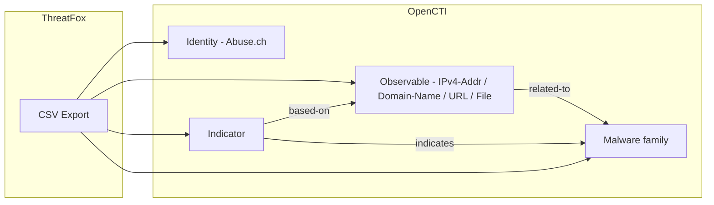

# OpenCTI ThreatFox Connector

| Status | Date | Comment |
|--------|------|---------|
| Community | -    | -       |

The ThreatFox connector imports indicators of compromise (IOCs) from abuse.ch ThreatFox into OpenCTI.

## Table of Contents

- [OpenCTI ThreatFox Connector](#opencti-threatfox-connector)
  - [Table of Contents](#table-of-contents)
  - [Introduction](#introduction)
  - [Installation](#installation)
    - [Requirements](#requirements)
  - [Configuration variables](#configuration-variables)
    - [OpenCTI environment variables](#opencti-environment-variables)
    - [Base connector environment variables](#base-connector-environment-variables)
    - [Connector extra parameters environment variables](#connector-extra-parameters-environment-variables)
  - [Deployment](#deployment)
    - [Docker Deployment](#docker-deployment)
    - [Manual Deployment](#manual-deployment)
  - [Usage](#usage)
  - [Behavior](#behavior)
  - [Debugging](#debugging)
  - [Additional information](#additional-information)

## Introduction

ThreatFox is a free platform from abuse.ch for sharing indicators of compromise (IOCs) associated with malware. The database contains IOCs like IP addresses, domains, URLs, and file hashes linked to specific malware families.

This connector fetches the recent IOC export from ThreatFox and imports them into OpenCTI as observables and indicators, with relationships to malware families when available.

## Installation

### Requirements

- OpenCTI Platform >= 6.x
- An abuse.ch Auth-Key, free from the [abuse.ch Authentication Portal](https://auth.abuse.ch)
- Internet access to the ThreatFox export endpoint (`threatfox-api.abuse.ch`)

## Configuration variables

There are a number of configuration options, which are set either in `docker-compose.yml` (for Docker) or in `config.yml` (for manual deployment).

### OpenCTI environment variables

| Parameter     | config.yml | Docker environment variable | Mandatory | Description                                          |
|---------------|------------|-----------------------------|-----------|------------------------------------------------------|
| OpenCTI URL   | url        | `OPENCTI_URL`               | Yes       | The URL of the OpenCTI platform.                     |
| OpenCTI Token | token      | `OPENCTI_TOKEN`             | Yes       | The default admin token set in the OpenCTI platform. |

### Base connector environment variables

| Parameter         | config.yml      | Docker environment variable   | Default         | Mandatory | Description                                                                 |
|-------------------|-----------------|-------------------------------|-----------------|-----------|-----------------------------------------------------------------------------|
| Connector ID      | id              | `CONNECTOR_ID`                |                 | Yes       | A unique `UUIDv4` identifier for this connector instance.                   |
| Connector Name    | name            | `CONNECTOR_NAME`              | ThreatFox       | No        | Name of the connector.                                                      |
| Connector Scope   | scope           | `CONNECTOR_SCOPE`             | threatfox       | No        | The scope or type of data the connector is importing.                       |
| Log Level         | log_level       | `CONNECTOR_LOG_LEVEL`         | error           | No        | Determines the verbosity of the logs: `debug`, `info`, `warn`, or `error`.  |

### Connector extra parameters environment variables

| Parameter            | config.yml                    | Docker environment variable         | Default                                       | Mandatory | Description                                                                 |
|----------------------|-------------------------------|-------------------------------------|-----------------------------------------------|-----------|-----------------------------------------------------------------------------|
| Auth-Key             | threatfox.auth_key            | `THREATFOX_AUTH_KEY`                |                                               | Yes       | abuse.ch Auth-Key, from https://auth.abuse.ch. Not needed if `THREATFOX_CSV_URL` is set. |
| CSV URL              | threatfox.csv_url             | `THREATFOX_CSV_URL`                 | https://threatfox-api.abuse.ch/v2/files/exports/`<AUTH-KEY>`/recent.csv | No        | Override of the ThreatFox CSV export URL. Takes precedence over `THREATFOX_AUTH_KEY`, except the retired public URL (`https://threatfox.abuse.ch/export/...`), which is ignored. |
| Import Offline       | threatfox.import_offline      | `THREATFOX_IMPORT_OFFLINE`          | true                                          | No        | Import IOCs marked as offline.                                              |
| Create Indicators    | threatfox.create_indicators   | `THREATFOX_CREATE_INDICATORS`       | true                                          | No        | Create indicators in addition to observables.                               |
| Default Score        | threatfox.default_x_opencti_score | `THREATFOX_DEFAULT_X_OPENCTI_SCORE` | 50                                        | No        | Fallback x_opencti_score, used only when an IOC has no usable ThreatFox `confidence_level` and no per-type override is set. |
| IP Score             | threatfox.x_opencti_score_ip  | `THREATFOX_X_OPENCTI_SCORE_IP`      | (uses confidence level)                       | No        | Fixed x_opencti_score for IP observables and indicators, overriding the ThreatFox confidence level. |
| Domain Score         | threatfox.x_opencti_score_domain | `THREATFOX_X_OPENCTI_SCORE_DOMAIN` | (uses confidence level)                      | No        | Fixed x_opencti_score for Domain observables and indicators, overriding the ThreatFox confidence level. |
| URL Score            | threatfox.x_opencti_score_url | `THREATFOX_X_OPENCTI_SCORE_URL`     | (uses confidence level)                       | No        | Fixed x_opencti_score for URL observables and indicators, overriding the ThreatFox confidence level. |
| Hash Score           | threatfox.x_opencti_score_hash | `THREATFOX_X_OPENCTI_SCORE_HASH`   | (uses confidence level)                       | No        | Fixed x_opencti_score for File (hash) observables and indicators, overriding the ThreatFox confidence level. |
| IOC Types            | threatfox.ioc_to_import       | `THREATFOX_IOC_TO_IMPORT`           | all_types                                     | No        | IOC types to import: `all_types`, `ip:port`, `domain`, `url`, `md5_hash`, `sha1_hash`, `sha256_hash`. |
| Interval             | threatfox.interval            | `THREATFOX_INTERVAL`                | 3                                             | Yes       | Interval in days between connector runs.                                    |

## Deployment

### Docker Deployment

Build the Docker image:

```bash
docker build -t opencti/connector-threatfox:latest .
```

Configure the connector in `docker-compose.yml`:

```yaml
  connector-threatfox:
    image: opencti/connector-threatfox:latest
    environment:
      - OPENCTI_URL=http://localhost
      - OPENCTI_TOKEN=ChangeMe
      - CONNECTOR_ID=ChangeMe
      - CONNECTOR_NAME=ThreatFox
      - CONNECTOR_SCOPE=threatfox
      - CONNECTOR_LOG_LEVEL=error
      - THREATFOX_AUTH_KEY=ChangeMe
      - THREATFOX_INTERVAL=3 # In days
      - THREATFOX_IMPORT_OFFLINE=true
      - THREATFOX_CREATE_INDICATORS=true
      - THREATFOX_DEFAULT_X_OPENCTI_SCORE=50
      - THREATFOX_IOC_TO_IMPORT=all_types
    restart: always
```

Start the connector:

```bash
docker compose up -d
```

### Manual Deployment

1. Create `src/config.yml` based on `config.yml.sample`, and set `threatfox.auth_key` to your abuse.ch Auth-Key. The connector reads `config.yml` (or `.env`) from the `src` directory.

2. Install dependencies from the connector directory:

```bash
pip3 install .
```

3. Start the connector:

```bash
threatfox-connector
```

## Usage

The connector runs automatically at the interval defined by `THREATFOX_INTERVAL`. To force an immediate run:

**Data Management → Ingestion → Connectors**

Find the connector and click the refresh button to reset the state and trigger a new sync.

## Behavior

The connector downloads the ThreatFox CSV export with the Auth-Key, converts each IOC to STIX, and sends everything in a single STIX bundle. It does not write to the OpenCTI API directly.

### Data Flow



### Entity Mapping

| ThreatFox IOC Type   | OpenCTI Entity      | Description                                      |
|----------------------|---------------------|--------------------------------------------------|
| ip:port              | IPv4-Addr           | IP address (port stored in description)          |
| domain               | Domain-Name         | Domain name                                      |
| url                  | URL                 | URL observable                                   |
| md5_hash             | File (MD5)          | MD5 file hash                                    |
| sha1_hash            | File (SHA-1)        | SHA-1 file hash                                  |
| sha256_hash          | File (SHA-256)      | SHA-256 file hash                                |
| Malware name         | Malware             | Malware family (`is_family: true`)               |

### Processing Details

For each IOC in the ThreatFox feed:

1. **Observable**: Created based on the IOC type with:
   - `x_opencti_score`: see [Scoring](#scoring)
   - Labels from the ThreatFox threat type and tags
   - The ThreatFox reference as an external reference, when the IOC has one

2. **Indicator** (when `THREATFOX_CREATE_INDICATORS=true`): Created with a STIX pattern matching the observable, the same score, the ThreatFox confidence level as `confidence`, and the same external reference. It is linked to the observable with a `based-on` relationship.

3. **Malware**: Created as a malware family when ThreatFox names one. The name comes from the printable malware name, or is derived from the malware identifier (for example `win.mirai` becomes `Mirai`); ThreatFox aliases and the identifier are kept as aliases. `botnet_cc` IOCs set the malware type to `bot`, and `payload_delivery` IOCs set it to `dropper`.

4. **Relationships**: The indicator `indicates` the malware, and the observable is `related-to` the malware, so the observable is linked to its family even without an indicator. Relationships carry the ThreatFox confidence level.

### External References

External references come only from the ThreatFox `reference` column, exactly as provided. The connector never builds a reference from the IOC value itself, so a malicious domain or URL is never turned into a clickable reference. IOCs without a reference get no external reference.

### Scoring

The `x_opencti_score` of observables and indicators is resolved per IOC, in this order:
1. The per-type override, when set: `THREATFOX_X_OPENCTI_SCORE_IP`, `THREATFOX_X_OPENCTI_SCORE_DOMAIN`, `THREATFOX_X_OPENCTI_SCORE_URL` or `THREATFOX_X_OPENCTI_SCORE_HASH`.
2. Otherwise, the ThreatFox `confidence_level` (0-100) of the IOC.
3. `THREATFOX_DEFAULT_X_OPENCTI_SCORE`, only when the confidence level is not usable.

## Debugging

Enable verbose logging:

```env
CONNECTOR_LOG_LEVEL=debug
```

When a run fails, the work shows `Connector run failed, see connector logs`, and the connector logs hold the cause. Common causes:
- `THREATFOX_AUTH_KEY is required` at startup: no Auth-Key is configured, so the connector exits before its first run.
- `THREATFOX_CSV_URL points to the retired public export and is ignored`: remove `THREATFOX_CSV_URL`, abuse.ch no longer serves `https://threatfox.abuse.ch/export/...`.
- `ThreatFox export download failed: HTTP 401` or `HTTP 403`: the Auth-Key is wrong or revoked.

## Additional information

- **Auth-Key**: abuse.ch requires an Auth-Key to download ThreatFox exports. Create an account on [abuse.ch Authentication Portal](https://auth.abuse.ch) to get one. The same key works for URLhaus. The export endpoint only accepts the key in the URL path, so the connector builds the URL from `THREATFOX_AUTH_KEY` and never logs it.
- **Failed runs**: if the run fails, the work is marked as failed and `last_run` is kept. The next attempt waits 1 minute, then 2, 4, 8... minutes after each new failure, up to the interval. A successful run resets the delay.
- **IOC Freshness**: The `csv_recent` endpoint provides IOCs from the last 7 days
- **Confidence Levels**: the ThreatFox confidence level sets the `confidence` of indicators, malware and relationships, and the score unless a per-type override is set
- **Reference**: [ThreatFox](https://threatfox.abuse.ch/)
