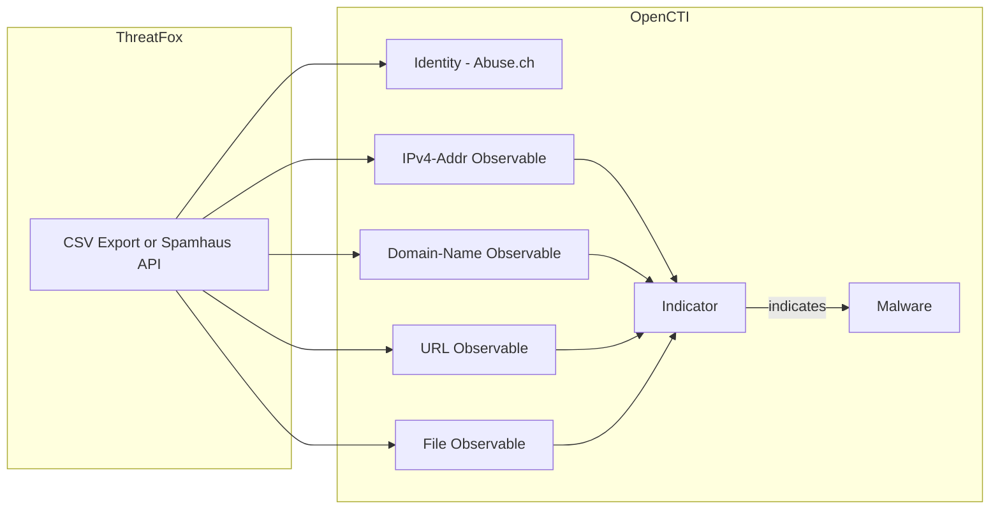

# OpenCTI ThreatFox Connector

| Status | Date | Comment |
|--------|------|---------|
| Community | -    | -       |

The ThreatFox connector imports indicators of compromise (IOCs) from abuse.ch ThreatFox into OpenCTI.

## Table of Contents

- [OpenCTI ThreatFox Connector](#opencti-threatfox-connector)
  - [Table of Contents](#table-of-contents)
  - [Introduction](#introduction)
  - [Installation](#installation)
    - [Requirements](#requirements)
  - [Configuration variables](#configuration-variables)
    - [OpenCTI environment variables](#opencti-environment-variables)
    - [Base connector environment variables](#base-connector-environment-variables)
    - [Connector extra parameters environment variables](#connector-extra-parameters-environment-variables)
  - [Authentication modes](#authentication-modes)
  - [Deployment](#deployment)
    - [Docker Deployment](#docker-deployment)
    - [Manual Deployment](#manual-deployment)
  - [Usage](#usage)
  - [Behavior](#behavior)
  - [Debugging](#debugging)
  - [Additional information](#additional-information)

## Introduction

ThreatFox is a free platform from abuse.ch for sharing indicators of compromise (IOCs) associated with malware. The database contains IOCs like IP addresses, domains, URLs, and file hashes linked to specific malware families.

This connector fetches the recent IOC export from ThreatFox and imports them into OpenCTI as observables and indicators, with relationships to malware families when available.

## Installation

### Requirements

- OpenCTI Platform >= 6.x
- Internet access to the ThreatFox source: the abuse.ch community API (`threatfox-api.abuse.ch`) or the Spamhaus commercial API (`api.spamhaus.com`)
- An abuse.ch Auth-Key (community) or a Spamhaus abuse.ch API account (commercial), see [Authentication modes](#authentication-modes)

## Configuration variables

There are a number of configuration options, which are set either in `docker-compose.yml` (for Docker) or in `config.yml` (for manual deployment).

### OpenCTI environment variables

| Parameter     | config.yml | Docker environment variable | Mandatory | Description                                          |
|---------------|------------|-----------------------------|-----------|------------------------------------------------------|
| OpenCTI URL   | url        | `OPENCTI_URL`               | Yes       | The URL of the OpenCTI platform.                     |
| OpenCTI Token | token      | `OPENCTI_TOKEN`             | Yes       | The default admin token set in the OpenCTI platform. |

### Base connector environment variables

| Parameter         | config.yml      | Docker environment variable   | Default         | Mandatory | Description                                                                 |
|-------------------|-----------------|-------------------------------|-----------------|-----------|-----------------------------------------------------------------------------|
| Connector ID      | id              | `CONNECTOR_ID`                |                 | Yes       | A unique `UUIDv4` identifier for this connector instance.                   |
| Connector Name    | name            | `CONNECTOR_NAME`              | ThreatFox       | No        | Name of the connector.                                                      |
| Connector Scope   | scope           | `CONNECTOR_SCOPE`             | threatfox       | No        | The scope or type of data the connector is importing.                       |
| Log Level         | log_level       | `CONNECTOR_LOG_LEVEL`         | error           | No        | Determines the verbosity of the logs: `debug`, `info`, `warn`, or `error`.  |

### Connector extra parameters environment variables

| Parameter            | config.yml                    | Docker environment variable         | Default                                       | Mandatory | Description                                                                 |
|----------------------|-------------------------------|-------------------------------------|-----------------------------------------------|-----------|-----------------------------------------------------------------------------|
| Auth-Key             | threatfox.auth_key            | `THREATFOX_AUTH_KEY`                |                                               | See below | abuse.ch Auth-Key (community mode), from https://auth.abuse.ch. Not needed if `THREATFOX_CSV_URL` or the Spamhaus credentials are set. |
| Spamhaus username    | threatfox.spamhaus_username   | `THREATFOX_SPAMHAUS_USERNAME`       |                                               | See below | Username of the Spamhaus abuse.ch API account (commercial mode), from the Spamhaus Customer Portal. Needs `THREATFOX_SPAMHAUS_PASSWORD`. |
| Spamhaus password    | threatfox.spamhaus_password   | `THREATFOX_SPAMHAUS_PASSWORD`       |                                               | See below | Password of the Spamhaus abuse.ch API account (commercial mode). Needs `THREATFOX_SPAMHAUS_USERNAME`. |
| CSV URL              | threatfox.csv_url             | `THREATFOX_CSV_URL`                 | https://threatfox-api.abuse.ch/v2/files/exports/`<AUTH-KEY>`/recent.csv | No        | Override of the ThreatFox CSV export URL (community mode). Takes precedence over `THREATFOX_AUTH_KEY`, except the retired public URL (`https://threatfox.abuse.ch/export/...`), which is ignored. |
| Import Offline       | threatfox.import_offline      | `THREATFOX_IMPORT_OFFLINE`          | true                                          | No        | Import IOCs marked as offline.                                              |
| Create Indicators    | threatfox.create_indicators   | `THREATFOX_CREATE_INDICATORS`       | true                                          | No        | Create indicators in addition to observables.                               |
| Default Score        | threatfox.default_x_opencti_score | `THREATFOX_DEFAULT_X_OPENCTI_SCORE` | 50                                        | No        | Default x_opencti_score for observables.                                    |
| IP Score             | threatfox.x_opencti_score_ip  | `THREATFOX_X_OPENCTI_SCORE_IP`      | (uses default)                                | No        | x_opencti_score for IP observables.                                         |
| Domain Score         | threatfox.x_opencti_score_domain | `THREATFOX_X_OPENCTI_SCORE_DOMAIN` | (uses default)                               | No        | x_opencti_score for Domain observables.                                     |
| URL Score            | threatfox.x_opencti_score_url | `THREATFOX_X_OPENCTI_SCORE_URL`     | (uses default)                                | No        | x_opencti_score for URL observables.                                        |
| Hash Score           | threatfox.x_opencti_score_hash | `THREATFOX_X_OPENCTI_SCORE_HASH`   | (uses default)                                | No        | x_opencti_score for Hash observables.                                       |
| IOC Types            | threatfox.ioc_to_import       | `THREATFOX_IOC_TO_IMPORT`           | all_types                                     | No        | IOC types to import: `all_types`, `ip:port`, `domain`, `url`, `md5_hash`, `sha1_hash`, `sha256_hash`. |
| Interval             | threatfox.interval            | `THREATFOX_INTERVAL`                | 3                                             | Yes       | Interval in days between connector runs.                                    |

## Authentication modes

The connector gets ThreatFox data in one of two ways. At least one must be configured: with neither, the connector fails at startup with a message naming both options.

| Mode | Configuration | Data source |
|------|---------------|-------------|
| Community | `THREATFOX_AUTH_KEY` (abuse.ch Auth-Key) | CSV export `recent.csv` on `threatfox-api.abuse.ch`. |
| Commercial | `THREATFOX_SPAMHAUS_USERNAME` and `THREATFOX_SPAMHAUS_PASSWORD` | `GET /threatfox/v1/iocs` on `api.spamhaus.com`, with a JWT. |

- **Both modes configured**: the commercial mode is used, and the Auth-Key is kept as a fallback.
- **Fallback**: if the commercial mode fails (login refused, network error, HTTP 5xx or 429, unusable response) and an Auth-Key is configured, the run uses the community export instead and logs a warning. The warning never holds a secret.
- **Commercial credentials only**: if they fail, the run fails, and the work message asks to check the Spamhaus credentials.
- **JWT**: the connector logs in once (`POST https://api.spamhaus.com/v1/login`, realm `abusech`), reuses the token (valid 24 hours) until shortly before its expiry, and logs in again once when the API answers HTTP 401. It never logs in for each request.
- **Incremental import**: with a JWT, the connector requests only the IOCs with `since` set to the last checkpoint (`last_processed_entry`, or the last 2 days on a first run), and follows every page of results.
- **User-Agent**: every request to Spamhaus sends `OpenCTI-threatfox/<version>`. Spamhaus rejects the default Python User-Agent.
- **Secrets**: the password, the JWT and the login response are never written to the logs or to the work messages.

## Deployment

### Docker Deployment

Build the Docker image:

```bash
docker build -t opencti/connector-threatfox:latest .
```

Configure the connector in `docker-compose.yml`:

```yaml
  connector-threatfox:
    image: opencti/connector-threatfox:latest
    environment:
      - OPENCTI_URL=http://localhost
      - OPENCTI_TOKEN=ChangeMe
      - CONNECTOR_ID=ChangeMe
      - CONNECTOR_NAME=ThreatFox
      - CONNECTOR_SCOPE=threatfox
      - CONNECTOR_LOG_LEVEL=error
      # Community mode: abuse.ch Auth-Key
      - THREATFOX_AUTH_KEY=ChangeMe
      # Commercial mode: Spamhaus credentials (wins over the Auth-Key, which then
      # stays as a fallback). Set at least one of the two modes.
      # - THREATFOX_SPAMHAUS_USERNAME=ChangeMe
      # - THREATFOX_SPAMHAUS_PASSWORD=ChangeMe
      - THREATFOX_INTERVAL=3 # In days
      - THREATFOX_IMPORT_OFFLINE=true
      - THREATFOX_CREATE_INDICATORS=true
      - THREATFOX_DEFAULT_X_OPENCTI_SCORE=50
      - THREATFOX_IOC_TO_IMPORT=all_types
    restart: always
```

Start the connector:

```bash
docker compose up -d
```

### Manual Deployment

1. Create `config.yml` based on `config.yml.sample`.

2. Install dependencies:

```bash
pip3 install -r requirements.txt
```

3. Start the connector from the `src` directory:

```bash
python3 -m __main__
```

## Usage

The connector runs automatically at the interval defined by `THREATFOX_INTERVAL`. To force an immediate run:

**Data Management → Ingestion → Connectors**

Find the connector and click the refresh button to reset the state and trigger a new sync.

## Behavior

The connector fetches the ThreatFox IOCs (the community CSV export, or the Spamhaus commercial API in commercial mode) and creates observables and indicators in OpenCTI. Both sources give the same STIX objects.

### Data Flow



### Entity Mapping

| ThreatFox IOC Type   | OpenCTI Entity      | Description                                      |
|----------------------|---------------------|--------------------------------------------------|
| ip:port              | IPv4-Addr           | IP address (port stored in description)          |
| domain               | Domain-Name         | Domain name                                      |
| url                  | URL                 | URL observable                                   |
| md5_hash             | File (MD5)          | MD5 file hash                                    |
| sha1_hash            | File (SHA-1)        | SHA-1 file hash                                  |
| sha256_hash          | File (SHA-256)      | SHA-256 file hash                                |
| Malware name         | Malware             | Malware family                                   |

### Processing Details

For each IOC in the ThreatFox feed:

1. **Observable**: Created based on IOC type with:
   - `x_opencti_score`: Configurable per type
   - Labels from ThreatFox tags
   - External reference to ThreatFox

2. **Indicator**: Created with STIX pattern matching the observable

3. **Malware Relationship**: If malware family is specified, creates `indicates` relationship

### Type-Specific Scoring

Configure different scores for different IOC types:
- IP addresses: `THREATFOX_X_OPENCTI_SCORE_IP`
- Domains: `THREATFOX_X_OPENCTI_SCORE_DOMAIN`
- URLs: `THREATFOX_X_OPENCTI_SCORE_URL`
- Hashes: `THREATFOX_X_OPENCTI_SCORE_HASH`

## Debugging

Enable verbose logging:

```env
CONNECTOR_LOG_LEVEL=debug
```

## Additional information

- **Spamhaus API**: the JSON of the commercial API differs from the CSV, but the IOC types and fields are mapped to the same entities. See the [API reference](https://abusech-docs.spamhaus.com/api-reference).
- **Auth-Key**: abuse.ch requires an Auth-Key to download ThreatFox exports. Create an account on [abuse.ch Authentication Portal](https://auth.abuse.ch) to get one. The same key works for URLhaus. The export endpoint only accepts the key in the URL path, so the connector builds the URL from `THREATFOX_AUTH_KEY` and never logs it.
- **Failed runs**: if the run fails, the work is marked as failed and `last_run` is kept. The next attempt waits 1 minute, then 2, 4, 8... minutes after each new failure, up to the interval. A successful run resets the delay.
- **IOC Freshness**: The `csv_recent` endpoint provides IOCs from the last 7 days
- **Confidence Levels**: ThreatFox includes confidence levels that can be reflected in scores
- **Reference**: [ThreatFox](https://threatfox.abuse.ch/)
