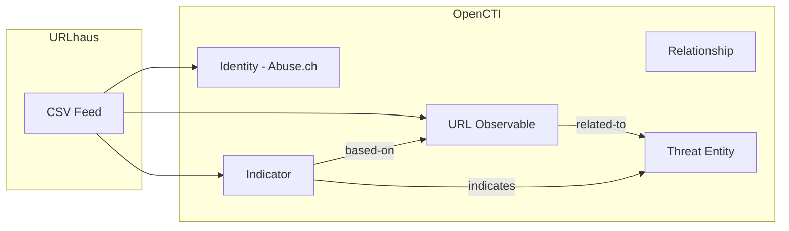

# OpenCTI URLhaus Connector

| Status | Date | Comment |
|--------|------|---------|
| Filigran Verified | -    | -       |

The URLhaus connector imports malicious URL data from abuse.ch URLhaus into OpenCTI as URL observables and indicators.

## Table of Contents

- [OpenCTI URLhaus Connector](#opencti-urlhaus-connector)
  - [Table of Contents](#table-of-contents)
  - [Introduction](#introduction)
  - [Installation](#installation)
    - [Requirements](#requirements)
  - [Configuration variables](#configuration-variables)
    - [OpenCTI environment variables](#opencti-environment-variables)
    - [Base connector environment variables](#base-connector-environment-variables)
    - [Connector extra parameters environment variables](#connector-extra-parameters-environment-variables)
  - [Deployment](#deployment)
    - [Docker Deployment](#docker-deployment)
    - [Manual Deployment](#manual-deployment)
  - [Usage](#usage)
  - [Behavior](#behavior)
  - [Debugging](#debugging)
  - [Additional information](#additional-information)

## Introduction

URLhaus is a project from abuse.ch with the goal of sharing malicious URLs that are being used for malware distribution. The service collects and tracks URLs that host malware, including download locations, C&C servers, and exploit kit landing pages.

This connector fetches the recent URL additions from URLhaus and imports them as URL observables and indicators into OpenCTI, with optional threat relationship creation.

## Installation

### Requirements

- OpenCTI Platform >= 6.x
- Internet access to the URLhaus API: `urlhaus-api.abuse.ch` (community mode) or `api.spamhaus.com` (commercial mode)
- One of the two authentication modes below

### Authentication modes

| Mode | Variables | Host | Data |
|------|-----------|------|------|
| Community | `URLHAUS_AUTH_KEY`: abuse.ch Auth-Key, free from the [abuse.ch Authentication Portal](https://auth.abuse.ch) | `urlhaus-api.abuse.ch`, `Auth-Key` in the export URL | `recent.csv` export (last 30 days) |
| Commercial | `URLHAUS_SPAMHAUS_USERNAME` and `URLHAUS_SPAMHAUS_PASSWORD`: Spamhaus abuse.ch API account, from the [Spamhaus Customer Portal](https://portal.spamhaus.com) | `api.spamhaus.com`, JWT in the `Authorization` header | `GET /urlhaus/v1/urls` since the last checkpoint, no daily export limit |

- At least one mode is required: the configuration is rejected at startup otherwise.
- When both are set, the commercial mode is used. If it cannot be used (network error, HTTP 5xx, rejected credentials), the connector logs a warning, which holds no secret, and falls back to the community export. With commercial credentials only, the run fails with a message asking to check the Spamhaus credentials.
- `URLHAUS_SPAMHAUS_USERNAME` and `URLHAUS_SPAMHAUS_PASSWORD` go together. The password is never logged nor written in a work message.
- `URLHAUS_SPAMHAUS_IMPORT_FROM` (ISO-8601 date or duration, default `P30D`) sets where the first commercial run starts. Later runs start from the last imported URL, and follow every page of results.

## Configuration variables

Find all the configuration variables available here: [Connector Configurations](./__metadata__/CONNECTOR_CONFIG_DOC.md)

_The `opencti` and `connector` options in the `docker-compose.yml` and `config.yml` are the same as for any other connector.
For more information regarding variables, please refer to [OpenCTI's documentation on connectors](https://docs.opencti.io/latest/deployment/connectors/)._

## Deployment

### Docker Deployment

Build the Docker image:

```bash
docker build -t opencti/connector-urlhaus:latest .
```

Configure the connector in `docker-compose.yml`:

```yaml
  connector-urlhaus:
    image: opencti/connector-urlhaus:latest
    environment:
      - OPENCTI_URL=http://localhost
      - OPENCTI_TOKEN=ChangeMe
      - CONNECTOR_ID=ChangeMe
      - CONNECTOR_NAME=Abuse.ch URLhaus
      - CONNECTOR_SCOPE=urlhaus
      - CONNECTOR_LOG_LEVEL=error
      - URLHAUS_INTERVAL=3
      # Community mode (and fallback of the commercial mode)
      - URLHAUS_AUTH_KEY=ChangeMe
      # Commercial mode, instead of or in addition to the Auth-Key
      # - URLHAUS_SPAMHAUS_USERNAME=ChangeMe
      # - URLHAUS_SPAMHAUS_PASSWORD=ChangeMe
      - URLHAUS_DEFAULT_X_OPENCTI_SCORE=80
      - URLHAUS_IMPORT_OFFLINE=true
      - URLHAUS_THREATS_FROM_LABELS=true
    restart: always
```

Start the connector:

```bash
docker compose up -d
```

### Manual Deployment

1. Create `config.yml` based on `config.yml.sample`.

2. Install dependencies:

```bash
pip3 install -r requirements.txt
```

3. Start the connector from the `src` directory:

```bash
python3 main.py
```

## Usage

The connector runs automatically at the interval defined by `URLHAUS_INTERVAL`. To force an immediate run:

**Data Management → Ingestion → Connectors**

Find the connector and click the refresh button to reset the state and trigger a new data fetch.

## Behavior

The connector fetches the recent URLs from URLhaus and creates URL observables and indicators in OpenCTI. In community mode it downloads the recent CSV export. In commercial mode it queries `GET /urlhaus/v1/urls` with `since` set to the last checkpoint (`URLHAUS_SPAMHAUS_IMPORT_FROM` on the first run) and follows the cursor pagination (`page_size` and `after`). The JWT obtained from `POST /v1/login` is reused until it is close to its expiry, and renewed once when the API answers 401. Every request carries the User-Agent `OpenCTI-urlhaus/rolling`.

### Data Flow



### Entity Mapping

| URLhaus CSV Field    | OpenCTI Entity/Property | Description                                      |
|----------------------|-------------------------|--------------------------------------------------|
| url                  | URL Observable          | Malicious URL value                              |
| url                  | Indicator               | STIX pattern `[url:value = '...']`               |
| dateadded            | Indicator.valid_from    | Date URL was added to URLhaus                    |
| url_status           | Indicator.description   | online/offline status                            |
| threat               | Indicator.description   | Threat type (malware, C&C, etc.)                 |
| tags                 | Observable.labels       | Malware family tags                              |
| urlhaus_link         | External Reference      | Link to URLhaus entry                            |
| reporter             | Indicator.description   | Reporter username                                |

### Commercial API fields

The JSON records of the commercial API are mapped to the same columns as the CSV export:

| Commercial API field | CSV column |
|----------------------|------------|
| `id` | `id` |
| `first_seen` | `dateadded` |
| `url` | `url` |
| `url_status` (`online`, `offline`, `unknown`) | `url_status` |
| `last_online` (omitted while the URL is online) | `last_online` |
| `threat` | `threat` |
| `tags` (list) | `tags` (comma-separated) |
| `urlhaus_reference` | `urlhaus_link` |
| `reporter` | `reporter` |

A record without `id`, `url`, `url_status`, `first_seen` or `urlhaus_reference` is skipped with a warning.

### CSV Schema

URLhaus CSV feed columns:
1. `id` - URLhaus ID
2. `dateadded` - Date/time added (UTC)
3. `url` - The malicious URL
4. `url_status` - online/offline
5. `last_online` - Last seen online
6. `threat` - Threat type
7. `tags` - Comma-separated malware tags
8. `urlhaus_link` - Reference URL
9. `reporter` - Reporter name

### Threat Relationships

When `URLHAUS_THREATS_FROM_LABELS=true`:
- Tags are used to search for existing threats in OpenCTI
- If a matching Threat-Actor, Intrusion-Set, Malware, Campaign, Incident, or Tool exists:
  - Indicator → `indicates` → Threat
  - URL → `related-to` → Threat

### Processing Details

1. **URL Observable**: Created with:
   - `x_opencti_score`: Configurable default score
   - Labels from URLhaus tags
   - External reference to URLhaus

2. **Indicator**: Created with:
   - Pattern: `[url:value = '<url>']`
   - `x_opencti_main_observable_type`: "Url"
   - Description includes threat type, reporter, status

3. **Relationship**: `based-on` from Indicator to Observable

4. **TLP Marking**: All data marked as TLP:WHITE

## Debugging

Enable verbose logging:

```env
CONNECTOR_LOG_LEVEL=debug
```

Log output includes:
- CSV download status, or the Spamhaus login and page requests (never the password nor the JWT)
- URL processing progress
- Threat relationship creation

## Additional information

- **Spamhaus rate limits**: the connector logs in once and reuses the JWT (valid 24 hours). Spamhaus throttles or blocks clients that log in for each request.
- **Auth-Key**: abuse.ch requires an Auth-Key to download URLhaus exports. Create an account on the [abuse.ch Authentication Portal](https://auth.abuse.ch) to get one. The same key works for ThreatFox and MalwareBazaar. The export endpoint only accepts the key in the URL path, so the connector builds `https://urlhaus-api.abuse.ch/v2/files/exports/<AUTH-KEY>/recent.csv` from `URLHAUS_AUTH_KEY` and never logs it.
- **Retired public feed**: the former default `URLHAUS_CSV_URL=https://urlhaus.abuse.ch/downloads/csv_recent/` answers 410 Gone. It is ignored when `URLHAUS_AUTH_KEY` is set; remove it from your configuration.
- **Recent export**: the export holds the URLs added in the last 30 days
- **Update Frequency**: URLhaus updates frequently; 3-hour polling is recommended
- **Offline URLs**: Set `URLHAUS_IMPORT_OFFLINE=false` to skip inactive URLs
- **High Score**: Default score of 80 reflects high confidence in URLhaus data
- **Reference**: [URLhaus](https://urlhaus.abuse.ch/)
