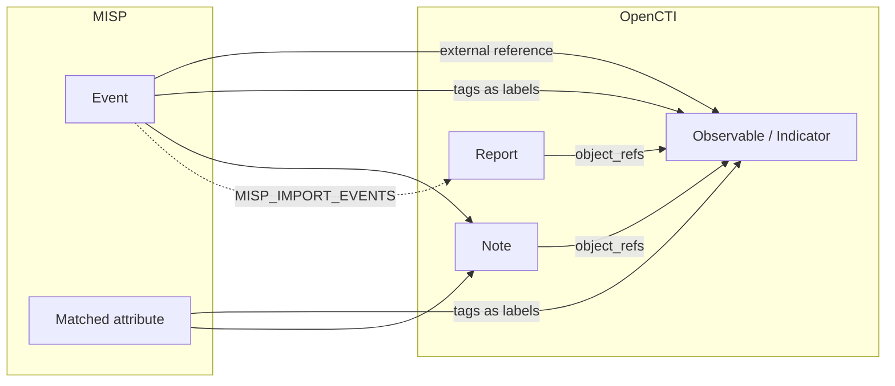

# OpenCTI MISP Enrichment Connector

Table of Contents

- [OpenCTI MISP Enrichment Connector](#opencti-misp-enrichment-connector)
  - [Introduction](#introduction)
  - [Installation](#installation)
    - [Requirements](#requirements)
  - [Configuration variables](#configuration-variables)
  - [Deployment](#deployment)
    - [Docker Deployment](#docker-deployment)
    - [Manual Deployment](#manual-deployment)
  - [Usage](#usage)
  - [Behavior](#behavior)
    - [Supported entities](#supported-entities)
    - [MISP lookup](#misp-lookup)
    - [Event filters](#event-filters)
    - [Enrichment output](#enrichment-output)
  - [Debugging](#debugging)

## Introduction

[MISP](https://www.misp-project.org/) (Malware Information Sharing Platform) is an open-source threat intelligence
platform for sharing, storing and correlating Indicators of Compromise.

This connector looks up an OpenCTI observable or STIX indicator in a MISP instance and, for every MISP event in which
it is found, adds to the entity an external reference to the event, a note describing the match and, optionally, the
MISP tags as labels and a report.

Unlike the [MISP import connector](../../external-import/misp), it does not copy MISP events into OpenCTI: it answers,
on demand, "is this IOC in my MISP, and in what context?".

## Installation

### Requirements

- OpenCTI Platform >= 6.8.12
- A MISP instance and an automation API key of a MISP user allowed to search attributes and read events

## Configuration variables

Find all the configuration variables available here: [Connector Configurations](./__metadata__/CONNECTOR_CONFIG_DOC.md)

_The `opencti` and `connector` options in the `docker-compose.yml` and `config.yml` are the same as for any other connector.
For more information regarding variables, please refer to [OpenCTI's documentation on connectors](https://docs.opencti.io/latest/deployment/connectors/)._

The connector-specific options are:

| Parameter                                 | config.yml                                     | Docker environment variable                     | Default | Description                                                                                         |
|-------------------------------------------|------------------------------------------------|-------------------------------------------------|---------|-----------------------------------------------------------------------------------------------------|
| MISP URL                                  | `misp.url`                                     | `MISP_URL`                                      |         | Base URL of the MISP instance.                                                                      |
| MISP API key                              | `misp.api_key`                                 | `MISP_API_KEY`                                  |         | MISP automation API key.                                                                            |
| SSL verification                          | `misp.ssl_verify`                              | `MISP_SSL_VERIFY`                               | `true`  | Verify the SSL certificate of the MISP instance.                                                    |
| Attribute tags as labels                  | `misp.import_attribute_tags_as_labels`         | `MISP_IMPORT_ATTRIBUTE_TAGS_AS_LABELS`          | `true`  | Apply the tags of the matched MISP attributes as labels on the entity.                              |
| Event tags as labels                      | `misp.import_associated_events_tags_as_labels` | `MISP_IMPORT_ASSOCIATED_EVENTS_TAGS_AS_LABELS`  | `false` | Apply the tags of the matched MISP events as labels on the entity.                                  |
| Creator organisations to include          | `misp.event_filter_creator_orgs`               | `MISP_EVENT_FILTER_CREATOR_ORGS`                |         | Comma-separated names or UUIDs. If set, only events created by one of these organisations are kept. |
| Creator organisations to exclude          | `misp.event_filter_creator_orgs_not`           | `MISP_EVENT_FILTER_CREATOR_ORGS_NOT`            |         | Comma-separated names or UUIDs.                                                                     |
| Owner organisations to include            | `misp.event_filter_owner_orgs`                 | `MISP_EVENT_FILTER_OWNER_ORGS`                  |         | Comma-separated names or UUIDs. If set, only events owned by one of these organisations are kept.   |
| Owner organisations to exclude            | `misp.event_filter_owner_orgs_not`             | `MISP_EVENT_FILTER_OWNER_ORGS_NOT`              |         | Comma-separated names or UUIDs.                                                                     |
| Event name regex                          | `misp.event_filter_name_regex`                 | `MISP_EVENT_FILTER_NAME_REGEX`                  |         | Only events whose name (`Event.info`) matches the regex are kept.                                   |
| Attribute comment regex                   | `misp.attribute_comment_filter_regex`          | `MISP_ATTRIBUTE_COMMENT_FILTER_REGEX`           |         | The comment of a matched attribute is written in the note only if it matches the regex.             |
| Import events as reports                  | `misp.import_events`                           | `MISP_IMPORT_EVENTS`                            | `false` | Create one report per matched MISP event, containing the entity.                                    |

The maximum TLP of the entities the connector sends to MISP is `CONNECTOR_MAX_TLP` (default `TLP:AMBER+STRICT`).

## Deployment

### Docker Deployment

Build a Docker Image using the provided `Dockerfile`.

```shell
docker build . -t opencti/connector-misp-enrichment:latest
```

Make sure to replace the environment variables in `docker-compose.yml` with the appropriate configurations for your
environment. Then, start the docker container with the provided `docker-compose.yml`:

```shell
docker compose up -d
```

### Manual Deployment

Create a file `config.yml` based on the provided `config.yml.sample`, and replace the `ChangeMe` values.

Install the required python dependencies (preferably in a virtual environment):

```shell
pip3 install -r src/requirements.txt
```

Then, start the connector from the `src` directory:

```shell
python3 main.py
```

## Usage

The connector is triggered:

- manually, from the enrichment button of an entity in OpenCTI;
- automatically, when `CONNECTOR_AUTO=true`, on entity creation or update;
- from a playbook, with the "Enrich through connector" component.

## Behavior

### Supported entities

| OpenCTI entity type | Values looked up in MISP                                                                                   |
|---------------------|------------------------------------------------------------------------------------------------------------|
| IPv4 address        | `value`                                                                                                    |
| IPv6 address        | `value`                                                                                                    |
| Domain name         | `value`                                                                                                    |
| URL                 | `value`                                                                                                    |
| Email address       | `value`                                                                                                    |
| File                | Every hash: SHA-256, SHA-1, MD5, SHA-512                                                                   |
| Indicator           | For a STIX pattern, every `ipv4-addr:value`, `ipv6-addr:value`, `domain-name:value`, `url:value`, `email-addr:value` and `file:hashes.*` comparison |

### MISP lookup

1. The attributes whose value is exactly one of the looked-up values are searched
   (`search(controller="attributes", value=...)`).
2. The full event of every distinct `event_id` found is retrieved (`get_event(event_id)`).
3. The events are filtered (see below).

A MISP error fails the enrichment: it is reported in the connector works, never mistaken for "no result".

### Event filters

All the configured filters are combined with a logical AND: an event must satisfy every one of them to be kept.
Organisations are compared by name or UUID, case-insensitively. The name regex is searched anywhere in the event name.

An event filtered out produces nothing: no external reference, no label, no note, no report.

### Enrichment output

Everything is sent in a STIX bundle, nothing is written through the API.



- **External references**: one per matched event, `MISP Event #<id>`, linking to `<MISP_URL>/events/view/<id>`, with the
  event name as description.
- **Labels**: the tags of the matched attributes (`MISP_IMPORT_ATTRIBUTE_TAGS_AS_LABELS`) and of the matched events
  (`MISP_IMPORT_ASSOCIATED_EVENTS_TAGS_AS_LABELS`).
- **Notes**: one per matched event, with the abstract `MISP match: <value> in "<event name>"`. The note describes each
  matched attribute (category, type, value, first and last seen, IDS flag, object, comment, tags), then the event
  (threat level, tags, URL, and the values of its "External analysis / comment" attributes). When
  `MISP_ATTRIBUTE_COMMENT_FILTER_REGEX` is set, an attribute comment is written only if it matches; the rest of the
  attribute is always written.
- **Reports** (optional): one per matched event, named after the event and containing the entity. Its ID is computed
  like the one of the MISP import connector, so both connectors converge on the same report.

An entity whose TLP is above `CONNECTOR_MAX_TLP`, or that has no MISP match, is left unchanged.
In a playbook, it is sent back as is, so that the playbook goes on.

## Debugging

The connector can be debugged by setting the appropriate log level (`CONNECTOR_LOG_LEVEL=debug`).
