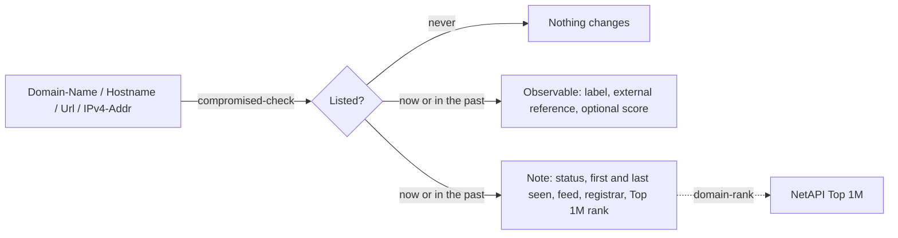

# OpenCTI NetAPI Connector

| Status    | Date | Comment |
|-----------|------|---------|
| Community | -    | -       |

The NetAPI connector checks domain names, hostnames, URLs and IPv4 addresses against the free [NetAPI compromised feed](https://netapi.com/compromised-urls/), the hosts that public threat feeds report for malware or phishing, and adds the position of a listed domain in the [NetAPI Top 1M](https://netapi.com/top-1-mln-websites/). No account or API key is needed.

## Table of Contents

- [Introduction](#introduction)
- [Installation](#installation)
- [Configuration variables](#configuration-variables)
- [Deployment](#deployment)
- [Usage](#usage)
- [Behavior](#behavior)
- [Debugging](#debugging)
- [Additional information](#additional-information)

## Introduction

[NetAPI](https://netapi.com/) publishes a feed of compromised domains and IP addresses collected from public threat feeds (URLhaus, CERT Polska, blackbook and others), refreshed daily, with the date each entry was first and last seen, and a daily Top 1M ranking of the most popular domains. Both are free (CC BY 4.0) and reachable through the [NetAPI JSON API](https://netapi.com/help/api/#json-api).

For each observable the connector makes one request to the `compromised-check` method and, for a listed domain, one more to `domain-rank`. A listed observable is enriched in place: it gets the label `netapi-compromised` while it is in the current feed, an external reference to NetAPI, optionally a score, and one note with the details. An observable that was never listed is left as it is.

## Installation

### Requirements

- OpenCTI Platform >= 7.261016.0
- No NetAPI account. An optional [API token](https://netapi.com/signinup/) (free accounts included) only raises the request limits: without one the API allows 30 requests a minute and 1,000 a day per IP address.

## Configuration variables

Configuration comes from environment variables or from `config.yml` (see `config.yml.sample`). The generated reference is in [`__metadata__/CONNECTOR_CONFIG_DOC.md`](./__metadata__/CONNECTOR_CONFIG_DOC.md).

### OpenCTI environment variables

| Parameter     | config.yml      | Docker environment variable | Mandatory | Description                                          |
|---------------|-----------------|-----------------------------|-----------|------------------------------------------------------|
| OpenCTI URL   | `opencti.url`   | `OPENCTI_URL`               | Yes       | The URL of the OpenCTI platform.                     |
| OpenCTI Token | `opencti.token` | `OPENCTI_TOKEN`             | Yes       | The default admin token set in the OpenCTI platform. |

### Base connector environment variables

| Parameter       | config.yml            | Docker environment variable | Default                               | Mandatory | Description                                                                                             |
|-----------------|-----------------------|-----------------------------|---------------------------------------|-----------|---------------------------------------------------------------------------------------------------------|
| Connector ID    | `connector.id`        | `CONNECTOR_ID`              |                                       | Yes       | A unique `UUIDv4` identifier for this connector instance.                                               |
| Connector Name  | `connector.name`      | `CONNECTOR_NAME`            | `NetAPI`                              | No        | Name of the connector.                                                                                  |
| Connector Scope | `connector.scope`     | `CONNECTOR_SCOPE`           | `Domain-Name,Hostname,IPv4-Addr,Url`  | No        | The observable types the connector enriches. Any subset of the default.                                 |
| Log Level       | `connector.log_level` | `CONNECTOR_LOG_LEVEL`       | `error`                               | No        | `debug`, `info`, `warn` or `error`.                                                                     |
| Auto            | `connector.auto`      | `CONNECTOR_AUTO`            | `false`                               | No        | Enrich new observables automatically. Off by default because of the keyless request limits.             |
| Max TLP         | `connector.max_tlp`   | `CONNECTOR_MAX_TLP`         | `amber`                               | No        | Highest TLP of the observables the connector sends to NetAPI. Observables above it are skipped.         |

### Connector extra parameters environment variables

| Parameter    | config.yml             | Docker environment variable | Default                        | Mandatory | Description                                                                                                   |
|--------------|------------------------|-----------------------------|--------------------------------|-----------|---------------------------------------------------------------------------------------------------------------|
| API token    | `netapi.api_token`     | `NETAPI_API_TOKEN`          |                                | No        | Optional NetAPI API token. The lookups are free without one; a token only raises the request limits.          |
| API base URL | `netapi.api_base_url`  | `NETAPI_API_BASE_URL`       | `https://netapi.com/api-json/` | No        | Base URL of the NetAPI JSON API.                                                                              |
| Timeout      | `netapi.timeout`       | `NETAPI_TIMEOUT`            | `30`                           | No        | HTTP request timeout in seconds.                                                                              |
| Include rank | `netapi.include_rank`  | `NETAPI_INCLUDE_RANK`       | `true`                         | No        | Add the Top 1M position of a listed domain to the note (one more request per listed domain or hostname).      |
| Update score | `netapi.update_score`  | `NETAPI_UPDATE_SCORE`       | `false`                        | No        | Write `score` to the observable when it is listed in the current feed. The existing score is overwritten.     |
| Score        | `netapi.score`         | `NETAPI_SCORE`              | `80`                           | No        | The score written when `update_score` is true (0 to 100).                                                     |
| TLP level    | `netapi.tlp_level`     | `NETAPI_TLP_LEVEL`          | `clear`                        | No        | TLP marking of the note, added to the markings of the source observable. The feed is public data.             |

## Deployment

### Docker Deployment

Build a Docker image using the provided `Dockerfile`:

```shell
docker build . -t opencti/connector-netapi:latest
```

Set the environment variables in `docker-compose.yml` (at least `OPENCTI_URL`, `OPENCTI_TOKEN` and `CONNECTOR_ID`), then start the container:

```shell
docker compose up -d
```

### Manual Deployment

Create `config.yml` from `config.yml.sample`, install the dependencies and start the connector from the `src` directory:

```shell
pip3 install -r requirements.txt
python3 main.py
```

## Usage

Open a Domain-Name, Hostname, Url or IPv4-Addr observable in OpenCTI and run the NetAPI enrichment from its Enrichment panel, or let it run automatically with `CONNECTOR_AUTO=true`. The connector can also be a step of a playbook: it always hands the bundle on, enriched or unchanged.

## Behavior

For each observable the connector:

1. checks the entity type against the scope and the TLP of the observable against `CONNECTOR_MAX_TLP` before anything leaves the platform.
2. takes the value to look up: a domain name or hostname in lower case and punycode, the host of a URL, or a public IPv4 address. Private and reserved addresses, IPv6 addresses and URLs without a host are skipped.
3. calls `compromised-check`. A hostname is also matched through its registered domain, and the answer says which entry matched, when it was first and last seen, the feed that reported it and the registrar of the domain.
4. calls `domain-rank` for a listed domain or hostname (`NETAPI_INCLUDE_RANK`).



What is sent back:

- **Listed now** (seen within the last 24 hours): the observable gets the label `netapi-compromised`, an external reference to the feed page and, when `NETAPI_UPDATE_SCORE` is true, the configured score. One note is attached with the status, the matched entry, first and last seen, the reporting feed, the registrar and the Top 1M rank.
- **Listed in the past only**: the same note and external reference, but no label and no score. The label `netapi-compromised` is removed if an earlier enrichment set it, so a cleaned-up host loses it on the next run. Most such entries reflect past incidents, often a legitimate site that was compromised and fixed.
- **Never listed**: nothing is changed or created. Absence from the feed is not a clearance.

The connector owns only the label `netapi-compromised` and its own external reference: labels and references of other sources stay as they are. The note's STIX id derives from the observable, so re-enrichment updates the note instead of adding another one. The note carries the TLP of `NETAPI_TLP_LEVEL` plus the markings of the observable.

An API failure (network error, HTTP error, request limit reached) puts the work in error with the message of the API, for example `NetAPI error 429 (rate_limited): Too many requests (retry after 42 s)`.

## Debugging

Set `CONNECTOR_LOG_LEVEL=debug` or `info` to see the value sent to NetAPI and the status of each enrichment. Every call can be reproduced with curl, for example:

```shell
curl "https://netapi.com/api-json/?method=compromised-check&value=example.com"
curl "https://netapi.com/api-json/?method=domain-rank&domain=example.com"
```

## Additional information

- The feed and the Top 1M are published by NetAPI under CC BY 4.0. Feed page: <https://netapi.com/compromised-urls/>, IP page: <https://netapi.com/compromised-ips/>, Top 1M: <https://netapi.com/top-1-mln-websites/>.
- API documentation: <https://netapi.com/help/api/#json-api>. The full lists are also available for download there (one domain or IP per line).
- Disclosure: this connector is contributed by NetAPI.
