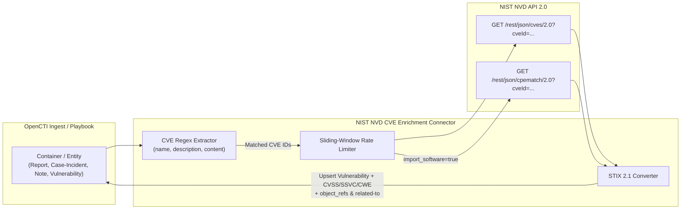

# OpenCTI NIST NVD CVE Enrichment Connector

The **NIST NVD CVE Enrichment** connector converts the traditional NVD CVE "firehose" import into a targeted, event-driven **Internal Enrichment (`INTERNAL_ENRICHMENT`)** connector.

Instead of importing 250,000+ CVEs that may never be relevant to your environment, this connector listens for ingested or enriched **Container** objects (`Report`, `Case-Incident`, `Case-Rfi`, `Case-Rft`, `Note`, `Grouping`, `Observed-Data`, `Opinion`, `Task`, `Feedback`), `Incident` entities, and `Vulnerability` entities:

1. **Regex CVE Extraction**: Scans the entity's `name`, `description`, `content`, `x_opencti_content`, and `abstract` fields for CVE naming patterns (including case-insensitive and defanged variants like `CVE[-]2024[-]3400`).
2. **Create If Missing & Enrich**: Queries the NIST NVD 2.0 API (`?cveId=CVE-...`) for each matched CVE, creates the `Vulnerability` STIX object if it does not yet exist in OpenCTI (or updates it if it does), and enriches it with:
   - **CVSS v2, v3.0, v3.1, and v4.0** scores, severities, vector strings, and impact metrics
   - **CISA SSVC** decision points (`exploitation`, `automatable`, `technical_impact`)
   - **CWE** weakness classifications (`x_opencti_cwe`)
   - **External References** & advisories
   - **Optional CPE Software Resolution**: When `CVE_IMPORT_SOFTWARE=true`, resolves affected CPEs via the NVD CPE Match API and creates `Software` SCOs with `has` relationships to the `Vulnerability`.
3. **Container & Graph Linking**: Appends all extracted/enriched `Vulnerability` (and optional `Software`) objects to the Container's `object_refs` and creates `related-to` relationships so they appear directly in the container's Knowledge Graph.

---

## Configuration Variables

Configuration options can be provided via `docker-compose.yml` environment variables, `.env`, or `src/config.yml`.
Runtime environment variables take precedence over `src/.env`, then `src/config.yml`, with defaults used last. Explicit settings passed to the loader take priority over these sources.

### OpenCTI Environment Variables

| Parameter     | config.yml | Docker environment variable | Mandatory | Description                                          |
|---------------|------------|-----------------------------|-----------|------------------------------------------------------|
| OpenCTI URL   | `opencti.url`   | `OPENCTI_URL`          | Yes       | The URL of the OpenCTI platform.                     |
| OpenCTI Token | `opencti.token` | `OPENCTI_TOKEN`        | Yes       | The token of the user representing the connector.    |

### Base Connector Environment Variables

| Parameter       | config.yml            | Docker environment variable | Default | Mandatory | Description |
|-----------------|-----------------------|-----------------------------|---------|-----------|-------------|
| Connector ID    | `connector.id`        | `CONNECTOR_ID`              |         | Yes       | Unique `UUIDv4` identifier for this connector instance. |
| Connector Type  | `connector.type`      | `CONNECTOR_TYPE`            | `INTERNAL_ENRICHMENT` | No | Must be `INTERNAL_ENRICHMENT`. |
| Connector Name  | `connector.name`      | `CONNECTOR_NAME`            | `NIST NVD CVE Enrichment` | No | Name of the connector. |
| Connector Scope | `connector.scope`     | `CONNECTOR_SCOPE`           | `Report,Grouping,Note,Observed-Data,Opinion,Case-Incident,Case-Rfi,Case-Rft,Task,Feedback,Incident,Vulnerability` | No | Target entity types that trigger enrichment. |
| Connector Auto  | `connector.auto`      | `CONNECTOR_AUTO`            | `true`  | No        | Automatically run enrichment when an in-scope entity is ingested. |
| Max TLP         | `connector.max_tlp`   | `CONNECTOR_MAX_TLP`         | `TLP:AMBER` | No    | Maximum TLP level of entities allowed to be enriched. |
| Log Level       | `connector.log_level` | `CONNECTOR_LOG_LEVEL`       | `info`  | No        | Log verbosity (`debug`, `info`, `warn`, `error`). |

### CVE Enrichment Parameters

| Parameter | config.yml | Docker environment variable | Default | Mandatory | Description |
|-----------|------------|-----------------------------|---------|-----------|-------------|
| API Key | `cve.api_key` | `CVE_API_KEY` | | Yes | Your NIST NVD API key. |
| Base URL | `cve.base_url` | `CVE_BASE_URL` | `https://services.nvd.nist.gov/rest/json/cves` | No | NVD CVE API endpoint URL. |
| Create Unmatched CVE | `cve.create_unmatched_cve` | `CVE_CREATE_UNMATCHED_CVE` | `true` | No | Create a placeholder `Vulnerability` in OpenCTI even if NVD has not published data for the extracted CVE ID yet. |
| Create Relationships | `cve.create_relationships` | `CVE_CREATE_RELATIONSHIPS` | `true` | No | Create `related-to` relationships linking extracted CVEs to the triggering container/entity in addition to `object_refs`. |
| Import Software | `cve.import_software` | `CVE_IMPORT_SOFTWARE` | `false` | No | Resolve CPEs for each matched CVE via the NVD CPE Match API and create `Software` objects with `has` relationships. |
| CPE History Interval | `cve.cpe_history_interval` | `CVE_CPE_HISTORY_INTERVAL` | `P120D` | No | Lookback window for CPE modifications when `import_software=true` (max 120 days). |
| CPE Max Concurrency | `cve.cpe_max_concurrency` | `CVE_CPE_MAX_CONCURRENCY` | `10` | No | Maximum concurrent CPE resolution tasks. |
| CVE Max Concurrency | `cve.cve_max_concurrency` | `CVE_CVE_MAX_CONCURRENCY` | `50` | No | Maximum concurrent CVE NVD lookup tasks per container. |
| Max CVEs Per Entity | `cve.max_cves_per_entity` | `CVE_MAX_CVES_PER_ENTITY` | `100` | No | Maximum distinct CVEs per entity; values above the hard limit of 100 are capped. |

Enrichment is processed and sent in chunks of at most five CVEs. Software resolution stops at 100 unique CPE names or 10 CPE Match API pages per CVE, whichever limit is reached first, and logs a warning when truncated. Each CVE creates at most 201 enrichment objects (one Vulnerability plus 100 Software objects and their relationships), plus one relationship to the source entity. These hard limits apply regardless of concurrency and history-window settings.

Source markings from both the STIX and OpenCTI representations are retained on generated objects and relationships, with marking definitions included in each chunk. Enrichment is refused before querying NVD if a source marking cannot be resolved.

NVD lookup and conversion errors fail the current chunk and are raised to the worker for direct enrichment events. A successful NVD response with no matching CVE can still create a placeholder when enabled. For playbooks, an error returns the last successfully sent bundle, preserving earlier chunks and their references; if no chunk succeeded, the original bundle is returned unchanged.

---

## Deployment

Both Docker builds apply `src/requirements-overrides.txt` after installing the regular dependencies to upgrade setuptools to a patched version. This deliberately overrides pycti's `setuptools~=82.0.0` metadata constraint. For manual installations, apply the override last:

```bash
pip install -r src/requirements.txt
pip install --upgrade --no-deps -r src/requirements-overrides.txt
```

Reapply the override after reinstalling dependencies. Until pycti relaxes its constraint, `pip check` will report the setuptools version conflict.

### Docker Deployment

Build the Docker image:

```bash
docker build -t opencti/connector-nvd-cve:latest .
```

Start the connector using `docker-compose.yml`:

```bash
docker compose up -d
```

### Manual Deployment

1. Copy `src/config.yml.sample` to `config.yml` and fill in your `OPENCTI_URL`, `OPENCTI_TOKEN`, and `CVE_API_KEY`.
2. Install dependencies:
   ```bash
   pip install -r src/requirements.txt
   ```
3. Run the connector:
   ```bash
   python -m src
   ```

---

## Data Flow


