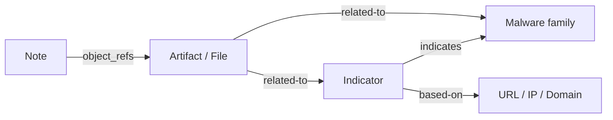

# OpenCTI Privara Unmask connector

| Status | Date | Comment |
|--------|------|---------|
| Community | - | - |

Privara Unmask is the Android malware sandbox that recovers the C2. Pay only for results.
It runs each sample on Android 17 (retried on Android 14 when a protector refuses 17) and extracts its
command-and-control (C2) servers, including servers hidden behind packers, dead-drop resolvers and
encrypted strings. Every C2 candidate is checked by a verifier and probed for liveness before it is
reported.

This internal-enrichment connector sends the Android package attached to an **Artifact** or
**File** observable to the Unmask API and imports the result into OpenCTI.

## Table of Contents

- [Cost: read this first](#cost-read-this-first)
- [Installation](#installation)
- [Configuration](#configuration)
- [Behavior](#behavior)
- [Troubleshooting](#troubleshooting)

## Cost: read this first

Unmask is billed **per result**, from a prepaid wallet on tajapps.com:

| Outcome | Meaning | Price |
|---|---|---|
| `live` | a C2 was found and answered during the analysis | $25 |
| `dead` | a C2 was found (high confidence) but did not answer | $9 |
| `none` | no C2 found | free |
| `void` | the analysis failed on the Privara side | free |

The same file again within 30 days returns the earlier charged (live or dead) result at no
charge; after a `none` or `void` result it is analysed again (free unless a C2 is found, but each
`none` counts towards the monthly fair use of 30). Refused files (not an Android package, known
clean app...) cost nothing. Each queued sample holds $25 of your
balance until it finishes. A free trial covers samples until the first C2 result (at most 10).

Because **every enrichment can cost money, `CONNECTOR_AUTO` is `false` by default**. Keep it that
way unless you really want every new Android file in OpenCTI analysed. Start enrichments by hand
(observable > Enrichment > Privara Unmask) or from a playbook that filters what it sends.

## Installation

### Requirements

- OpenCTI Platform >= 6.8.12
- An Unmask API key: sign up on [tajapps.com/unmask](https://tajapps.com/unmask/) ("Try free"),
  top up the wallet, then create a key on the
  [API keys page](https://app.tajapps.com/dashboard/unmask/api) (Dashboard > Unmask API) with the
  `submit` and `read` scopes. Use one key per integration so you can revoke it on its own.
- Outbound HTTPS from the connector to `app.tajapps.com` (port 443).

### Docker

```shell
docker build . -t opencti/connector-privara-unmask:latest
```

Fill in `docker-compose.yml` (at least `OPENCTI_URL`, `OPENCTI_TOKEN`, `CONNECTOR_ID` and
`PRIVARA_UNMASK_API_KEY`), add the service to your OpenCTI stack and start it:

```shell
docker compose up -d
```

### Manual

```shell
cd src
pip3 install -r requirements.txt
cp ../config.yml.sample ../config.yml   # then edit it
python3 main.py
```

## Configuration

Settings are read from environment variables or from `config.yml` (environment wins). The full,
generated list is in [`__metadata__/CONNECTOR_CONFIG_DOC.md`](__metadata__/CONNECTOR_CONFIG_DOC.md).

| Parameter | config.yml | Environment variable | Default | Description |
|---|---|---|---|---|
| OpenCTI URL | `opencti.url` | `OPENCTI_URL` | | The URL of the OpenCTI platform. |
| OpenCTI token | `opencti.token` | `OPENCTI_TOKEN` | | The token of the OpenCTI user the connector runs as. |
| Connector ID | `connector.id` | `CONNECTOR_ID` | | A unique UUIDv4 for this connector. |
| Scope | `connector.scope` | `CONNECTOR_SCOPE` | `Artifact,StixFile` | Entity types the connector enriches. |
| Auto | `connector.auto` | `CONNECTOR_AUTO` | `false` | Enrich new files automatically. **Each run can be charged.** |
| Max TLP | `connector.max_tlp` | `CONNECTOR_MAX_TLP` | `amber` | Files marked above this TLP are never sent to Privara. |
| API key | `privara_unmask.api_key` | `PRIVARA_UNMASK_API_KEY` | | Unmask API key (`pvu_...`). Never logged. |
| API URL | `privara_unmask.api_base_url` | `PRIVARA_UNMASK_API_BASE_URL` | `https://app.tajapps.com/api/unmask/v1` | HTTPS only. |
| Max wait | `privara_unmask.max_wait` | `PRIVARA_UNMASK_MAX_WAIT` | `3600` | Seconds to wait for one analysis. |
| Poll interval | `privara_unmask.poll_interval` | `PRIVARA_UNMASK_POLL_INTERVAL` | `30` | Delay between status checks when the API sends no `Retry-After` (grows to 120 s, never below 15 s). |
| Max file size | `privara_unmask.max_file_size_mb` | `PRIVARA_UNMASK_MAX_FILE_SIZE_MB` | API limit | Optional lower cap. By default the API's own limit (`GET /balance`, `limits.max_file_mb`) is used. |
| Create observables | `privara_unmask.create_observables` | `PRIVARA_UNMASK_CREATE_OBSERVABLES` | `true` | Also create URL / IP / domain observables for the C2. |
| Result e-mail | `privara_unmask.notify_email` | `PRIVARA_UNMASK_NOTIFY_EMAIL` | account setting | Ask Privara to e-mail each result. |

## Behavior

For each enrichment the connector:

1. checks the observable's TLP against `CONNECTOR_MAX_TLP`;
2. downloads the attached file and checks **locally** that it is an Android package (APK, or an
   XAPK / APKM / .apks bundle) under the API's size limit. Anything else is never sent to Privara;
3. looks the SHA-256 up (`GET /jobs?sha256=`, free): a charged result (live or dead) from the
   last 30 days is reused as it is (no upload, no new charge) and a running job is waited for.
   Otherwise it uploads the file with the `Idempotency-Key` `opencti-<sha256>` (after an earlier
   `none` / `void` / failed job, with a suffix derived from that job, so the file really runs
   again), so a retry is never charged twice. It then polls the job, following the API's
   `Retry-After` (30 s while running; never faster than every 15 s), until it finishes or
   `max_wait` runs out. Job ids are opaque and used exactly as the API returns them;
4. sends one STIX 2.1 bundle (with the observable's markings):



| Unmask field | OpenCTI |
|---|---|
| each `c2[].value` | Indicator with a STIX pattern on the raw value (`url`, `ipv4-addr`, `ipv6-addr`, `domain-name`; host:port becomes a `network-traffic` pattern), score 90 (live) or 60 (dead), kill chain phase `command-and-control`, labels `c2` and `c2-live` / `c2-dead`; the API's confidence and liveness check are in the description (STIX `confidence` is left to your platform's confidence policy) |
| `c2[].liveness`, `c2[].intel` | in the indicator description and the Note's C2 table: whether the C2 answered, the check's explanation (including the AI review's sentence when it lowered a result) and whether abuse.ch (ThreatFox, URLhaus, Feodo) already lists it. Information only: never changes the charge |
| `kind` / `host` / `port` | the pattern type (`url`, `ip`, `domain`, `host_port`); the value is never parsed, and an unknown kind is only listed in the Note |
| `family.name` | Malware (family) |
| outcome, charge, Android versions, defanged C2 table, `web_url` | Note on the observable |
| `rejected_candidates` | only counted in the Note, **never** turned into indicators |
| `job_id`, `web_url` | external reference on the indicators and the Note (the job page on tajapps.com, after sign-in) |
| `status` `failed` / `canceled` (outcome null) | Note "the analysis failed / was canceled (not charged)" |

When there is no result the connector still explains why, with a Note on the observable:

| Situation | What you see | Charged |
|---|---|---|
| File refused by Privara | Note "file refused" with the reason (`not_apk`, `bad_archive`, `manifest_unreadable`, `too_large`, `zip_bomb`, `unsafe_entry`, `known_clean`, `duplicate_in_batch`) | no |
| Wallet too low (HTTP 402) | Note with the top-up link; new uploads pause for 10 minutes | no |
| Fair-use limit reached (HTTP 403) | Note; new uploads pause for 10 minutes | no |
| Rate limited (HTTP 429 after the client's own retries, which honour `Retry-After`) | Note "rate limited"; enrich again in a few minutes (no pause) | no |
| Same upload still being processed (HTTP 409 `idempotency_in_progress`) | retried after `Retry-After`, same key | once |
| Still running after `max_wait` | Note with the job id; enrich again later: the job is found by its SHA-256 | when it finishes |
| Not an Android package / too big / no file | message on the enrichment work only, nothing sent | no |
| `invalid_key` (401), `missing_scope` (403), `not_found` (404; on upload: the Unmask API is not enabled for the account) | the work ends in error with a clear message | no |

The connector is playbook compatible: in a playbook (a message without `event_type`) it always
returns the incoming bundle, enriched when there is a result, also when the entity is skipped
(out of scope or above the max TLP).

## Troubleshooting

- **"The Unmask API key is invalid or revoked"** / **"lacks a scope"**: create a new key on the
  [API keys page](https://app.tajapps.com/dashboard/unmask/api) with the `submit` and `read` scopes.
- **"The Unmask API is not enabled for this Privara account"**: the account has no Unmask API plan
  yet; start at [tajapps.com/unmask](https://tajapps.com/unmask/).
- **Analyses time out**: raise `PRIVARA_UNMASK_MAX_WAIT` (some samples need the Android 14 fallback
  run). Enriching the file again later picks up the same job (found by its SHA-256).
- **Nothing is sent for a File observable**: File observables need the sample attached
  (Data > Files). Hash-only observables cannot be analysed.
- Set `CONNECTOR_LOG_LEVEL=debug` for details. The API key never appears in logs.

The report link in the Note opens the job on your tajapps.com dashboard (sign-in required).
