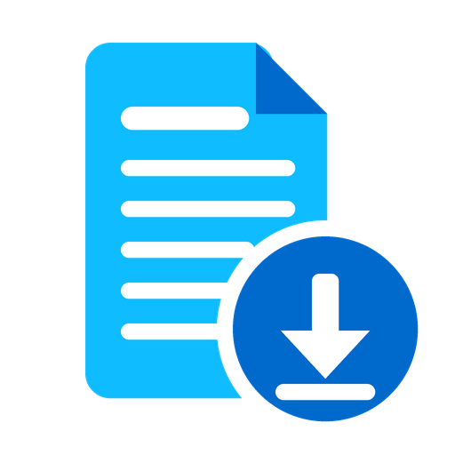

# OpenCTI Report Article Fetcher



Fills the **Content** of a report with the full article behind its external
reference. Its main use is the reports an RSS feed ingestion creates, which
only carry the feed's teaser: by default, only those are enriched
(`match_single_reference` extends it to any report with one external
reference).

| Type | Internal enrichment, scope `Report` |
|---|---|
| Playbook | Compatible: always sends the report back, filled or unchanged |
| Connector manager | Supported (`__metadata__/connector_config_schema.json`) |

## What it does

1. **Finds the article link.** By default, only the external reference written
   by the RSS ingestion is used: its `source_name` is the report name and its
   description ends with `Retrieved <date>.`. With `match_single_reference`, a
   report with exactly one external reference is accepted too, whatever created
   it. A report with no candidate, or several, is left unchanged. External references are shared by every report citing the
   same URL, so the trigger is the report, never the reference.
2. **Fetches the page over plain HTTP.** Every address the host resolves to must
   be public (no loopback, private, link-local or metadata address), at each
   redirect, and so must the address the connection actually reaches, which
   defeats DNS rebinding. HTML only, 5 MB at most (a larger `Content-Length` is
   refused before reading), 20 s timeout, 5 redirects at most, a redirect
   without `Location` refused, `<meta refresh>` stubs followed.
3. **Keeps the article body** with [trafilatura](https://trafilatura.readthedocs.io)
   (Apache-2.0): no menus, footers, cookie banners or comments; tables, lists,
   code and links kept.
   Sponsored ad units the publisher injects inside the article (a paid display
   callout: heading, promo text, call to action) are removed first: they are
   told by the paid-advertising tracking of their links (`utm_medium=paid*` or
   `utm_source=display_network`), on any site. Links with another medium
   (`3rd-party`, `referral`...) are article content and stay.
   Three layouts that would lose indicators are reworked first: tables nested in
   wrapper `<div>`s (Google Docs exports) are lifted out, the `embed` classes
   around tables (Webflow) are dropped, and indicators listed one per `<div>`
   become a list.
   In-page anchors (`<a id>` or `<a name>` before a heading, links to `#part`
   of the page) are unwrapped, their text kept, and the body is written with
   HTML rules, so no empty link is left open in the report's content.
   An article laid out as a run of sibling blocks of the same kind, figures
   between them (Adobe AEM `div.cmp-text`), is gathered into one body first, so
   every block is kept in order; the page's layout attributes (`class`, `id`,
   `style`, `data-*`) are not written to the content.
4. **Follows the PDF report of a landing page.** Some publishers put only a
   summary at the article URL and link the report itself as a PDF ("Download
   the report", "Télécharger le rapport"). When the extracted text is shorter
   than 4,000 characters and the article links a PDF on the page's registrable
   domain, that PDF is fetched with the same checks as a page (public addresses
   at every hop, 20 MB at most, `application/pdf` starting with `%PDF` only).
   Only the links of the extracted article count, so the PDFs of the site's
   menu or footer are never followed; a link whose text names the report wins
   over another PDF. Its text, read with [pypdf](https://pypdf.readthedocs.io)
   (BSD-3-Clause), is added after the summary as paragraphs, running headers,
   footers and page numbers dropped, and the PDF is attached to the report.
   Any failure there (too large, not a PDF, no text) keeps the summary alone,
   with a warning saying why; it never fails the enrichment.
5. **Checks it is the article** (on a landing page, the summary and the report
   together): not an anti-bot or consent page, at least 500
   characters, and matching the report (page title, the report name's words at
   the top of the text, or the URL slug). When the article body was found as a
   run of blocks, the extraction must keep at least 60% of its text: it is
   retried on that body alone, then refused as a partial article, never
   written partial. When the report's content is already
   filled, the article must also be 1.5 times longer than it, so a full text is
   never replaced by less; an empty content replaces nothing.
6. **Writes the body to the report's content** through a bundle, so confidence
   levels and playbooks apply, with the PDF report attached when one was
   followed. The description is left as it is.

## Confidence of the connector's user

The report goes back as an upsert of the existing report, and the platform
replaces a filled content only when the confidence of the connector's user is
at least the report's confidence. Give the connector's user (or its group) a
max confidence level at least as high as the reports it enriches, for instance
the confidence of the RSS ingestion's user; otherwise a report whose content is
already filled keeps it. An empty content is always filled.

## Trigger it

Through a playbook (*report created*, filtered on the feed's author or the
ingestion's user, then this connector) or by manual enrichment. Keep
`CONNECTOR_AUTO=false`: in automatic mode every report created would be tried.

## Configuration

The full list of variables, generated from the settings model, is in
[`__metadata__/CONNECTOR_CONFIG_DOC.md`](__metadata__/CONNECTOR_CONFIG_DOC.md).
The generic `OPENCTI_*` and `CONNECTOR_*` variables are those of every internal
enrichment connector (see `docker-compose.yml`). The connector's own settings,
all optional, use the `REPORT_ARTICLE_FETCHER_` prefix:

| Variable | Default | Description |
|---|---|---|
| `REPORT_ARTICLE_FETCHER_USER_AGENT` | `OpenCTI Report Article Fetcher` | User-Agent sent when fetching article pages |
| `REPORT_ARTICLE_FETCHER_REQUEST_TIMEOUT` | `20` | Timeout of one page request, in seconds |
| `REPORT_ARTICLE_FETCHER_MAX_DOWNLOAD_SIZE` | `5000000` | Largest page downloaded, in bytes |
| `REPORT_ARTICLE_FETCHER_MIN_LENGTH` | `500` | Shortest article accepted, in characters of text |
| `REPORT_ARTICLE_FETCHER_LENGTH_RATIO` | `1.5` | How many times longer than the report's current content the article must be |
| `REPORT_ARTICLE_FETCHER_MIN_TITLE_SIMILARITY` | `0.6` | Lowest match accepted between the report name and the page, from 0 to 1 |
| `REPORT_ARTICLE_FETCHER_FOLLOW_PDF` | `true` | On a landing page, also fetch the PDF report it links: its text follows the page and the file is attached to the report |
| `REPORT_ARTICLE_FETCHER_LANDING_MAX_LENGTH` | `4000` | A page shorter than this, in characters of text, is a landing page whose PDF report is followed |
| `REPORT_ARTICLE_FETCHER_MAX_PDF_SIZE` | `20000000` | Largest PDF report downloaded, in bytes |
| `REPORT_ARTICLE_FETCHER_MATCH_SINGLE_REFERENCE` | `false` | Also enrich reports not created by an RSS ingestion when they have exactly one external reference |
| `REPORT_ARTICLE_FETCHER_MAX_WORKERS` | `1` | Reports processed at the same time by one connector process (1 to 32) |
| `REPORT_ARTICLE_FETCHER_SUMMARY_LOG_LEVEL` | `error` | Level of the one-line summary of each report (`debug`, `info`, `warning`, `error`, `none`) |

## Throughput and scale-out

A playbook does not wait for the connector: every report of a batch is queued
at once, and the connector drains the queue. One worker handles one report at
a time (most of it is waiting for the article's site), so a batch of reports
goes through one by one unless more workers consume the queue.

- **In one container:** `REPORT_ARTICLE_FETCHER_MAX_WORKERS=4` runs 4 workers.
  Each worker has its own OpenCTI client, queue consumer and HTTP session, so
  the playbook context of one report never reaches another: it is the same as
  running 4 replicas, in one process. It needs the default AMQP listen
  protocol, and cannot be combined with `CONNECTOR_EXPOSE_METRICS` (each
  worker would open the metrics port).
- **Across containers:** run several replicas of the connector with the same
  `CONNECTOR_ID`; they share its queue. This is the way to scale beyond one
  host, or with metrics exposed.

A worker keeps its HTTP connections open between reports (articles of one
feed come from the same site), with its cookies cleared at each article, and
extracts each page in a single pass.

## Logs

Each report gets one summary line, at the level of
`REPORT_ARTICLE_FETCHER_SUMMARY_LOG_LEVEL` (`error` by default, so that it is
visible under the default `CONNECTOR_LOG_LEVEL=error`; `none` turns it off):

```
Report skipped {"report_id": "report--...", "outcome": "skipped", "reason": "Skipped: HTTP 403", "total_ms": 412, "fetch_ms": 398, "send_ms": 12}
```

`outcome` is `enriched`, `skipped` or `error`; `reason` says why a report was
left unchanged; `fetch_ms` (redirects included), `extract_ms`, `judge_ms` and
`send_ms` say where the time went, and `total_ms` is the whole report.

A report deleted while it waited in the queue is not read by the connector:
pycti logs it as `Unable to read/access to the entity` before the connector
sees the message.

## Evaluation

Run on the 3 latest items of the 69 RSS feeds of the XTM Hub catalog and 14
other security feeds (2026-11-03): every page reachable over plain HTTP was
fetched, no headless browser needed, in 0.1 to 3 s. On 162 pages fetched by
both this connector and Import External Reference, the same pages were
retrieved; the whole-page Markdown of Import External Reference held a median
45% of non-article text (menus, footers, related posts), which this connector
leaves out, with as many indicators kept.

## Known limits

- Sponsored blocks inside an article are kept (Bleeping Computer).
- A feed item linking to an anchor of an index page is accepted (XPN).
- Pages behind an anti-bot challenge or a consent wall are not fetched: the
  connector never tries to get around them.
- PDF articles are not handled.
