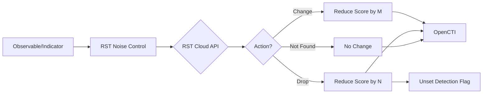

# OpenCTI RST Noise Control Connector

| Status | Date | Comment |
|--------|------|---------|
| Partner Verified | -    | -       |

## Table of Contents

- [Introduction](#introduction)
- [Installation](#installation)
  - [Requirements](#requirements)
- [Configuration](#configuration)
- [Deployment](#deployment)
  - [Docker Deployment](#docker-deployment)
  - [Manual Deployment](#manual-deployment)
- [Usage](#usage)
- [Behavior](#behavior)
  - [Data Flow](#data-flow)
  - [Actions](#actions)
  - [Processing Details](#processing-details)
- [Debugging](#debugging)
- [Additional Information](#additional-information)

---

## Introduction

The [RST Noise Control](https://www.rstcloud.com/rst-noise-control/) connector checks if observables and indicators are benign or potentially noisy and not worth detecting. It helps reduce false positives by identifying well-known, popular, or benign values that could trigger false alerts.

Key features:
- Identify benign/noisy indicators
- Customizable score adjustments
- Detection flag management
- Trusted source filtering
- Pay-as-you-go pricing model

---

## Installation

### Requirements

- OpenCTI Platform >= 6.0.0
- RST Cloud API key ([Get one here](https://aws.amazon.com/marketplace/pp/prodview-bmd536bqonz22) or contact trial@rstcloud.net)
- Network access to RST Cloud API

---

## Configuration

Find all the configuration variables available here: [Connector Configurations](./__metadata__/CONNECTOR_CONFIG_DOC.md)

_The `opencti` and `connector` options in the `docker-compose.yml` and `config.yml` are the same as for any other connector.
For more information regarding variables, please refer to [OpenCTI's documentation on connectors](https://docs.opencti.io/latest/deployment/connectors/)._

In `config.yml`, the connector parameters go in the `rst_noise_control` section (the legacy `rst-noise-control` section name is still accepted).

---

## Deployment

### Docker Deployment

Build a Docker Image using the provided `Dockerfile`.

Example `docker-compose.yml`:

```yaml
version: '3'
services:
  connector-rst-noise-control:
    image: opencti/connector-rst-noise-control:latest
    environment:
      - OPENCTI_URL=http://localhost
      - OPENCTI_TOKEN=ChangeMe
      - CONNECTOR_ID=ChangeMe
      - RST_NOISE_CONTROL_API_KEY=ChangeMe
    restart: always
```

### Manual Deployment

1. Clone the repository
2. Copy `src/config.yml.sample` to `src/config.yml` and configure
3. Install dependencies: `pip install -r requirements.txt`
4. Run the connector

---

## Usage

The connector reduces false positives by:
1. Checking indicators against RST Noise Control database
2. Identifying benign or noisy values
3. Adjusting scores based on findings
4. Optionally unsetting detection flags

Trigger enrichment:
- Manually via the OpenCTI UI
- Automatically if `CONNECTOR_AUTO=true`
- Via playbooks

---

## Behavior

### Data Flow



### Actions

| Action | Description | Default Score Change |
|--------|-------------|---------------------|
| Not Found | Value is not marked as noisy | No change |
| Change | Value may be noisy | Reduce score by 10 |
| Drop | Value is likely benign | Reduce score by 50 |

### Processing Details

1. **Score Reduction**: Scores are reduced by the configured amount, with a minimum of 0
2. **Detection Flag**: When action is "Drop" and `drop_action_detection_flag=true`, the detection flag is unset
3. **Trusted Filter List**: Add trusted IoC sources to a filter list to avoid API calls for known-good sources

---

## Debugging

Enable debug logging by setting `CONNECTOR_LOG_LEVEL=debug` to see:
- API request/response details
- Action decisions
- Score adjustment calculations

---

## Additional Information

- [RST Cloud](https://www.rstcloud.com/)
- [RST Noise Control](https://www.rstcloud.com/rst-noise-control/)
- [AWS Marketplace](https://aws.amazon.com/marketplace/pp/prodview-bmd536bqonz22)
- Contact: trial@rstcloud.net

### Use Cases

- **Reduce Alert Fatigue**: Automatically lower scores for common benign indicators
- **Improve Detection Accuracy**: Unset detection flags for noisy indicators
- **Prioritize True Threats**: Focus analyst attention on genuine threats
